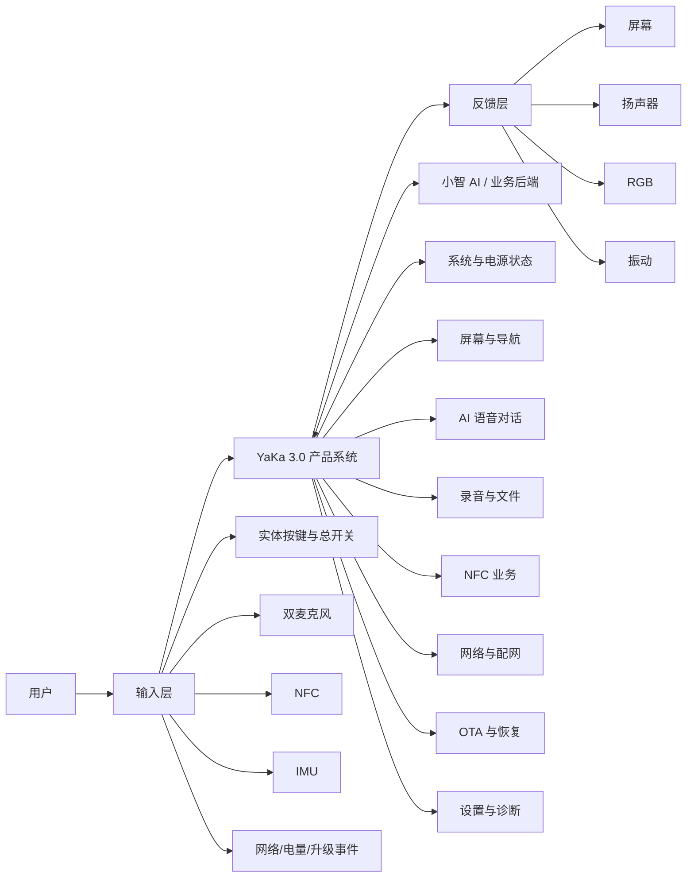
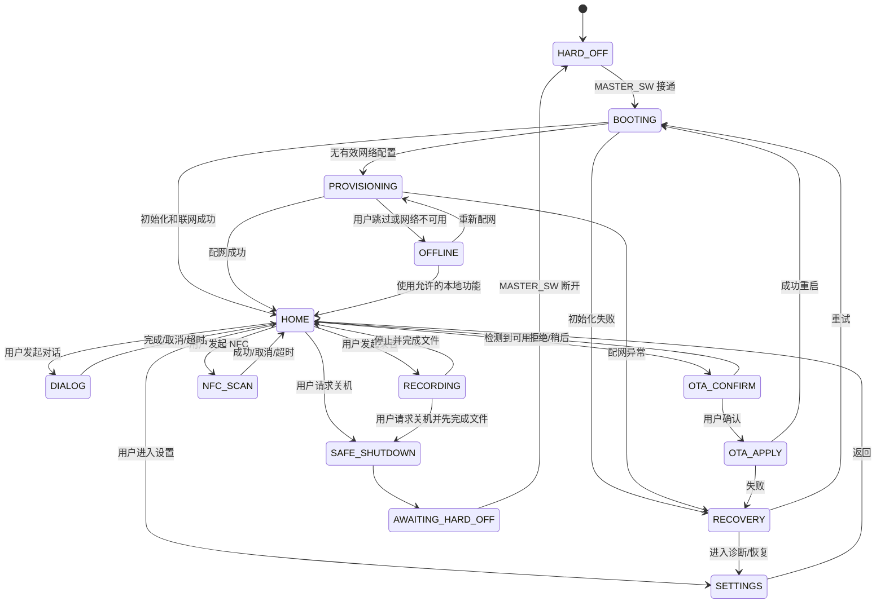

# YaKa 3.0 产品需求文档（PRD）

> 本文定义 YaKa 3.0 为什么做、为谁做、做什么、如何交互，以及达到什么条件才算完成。本文不承担原理图、PCB、器件选型、缺陷清单或工程修复说明；上述内容由工程基线、审计报告和验证记录分别管理。

## 0. 文档控制

| 字段 | 当前值 |
|-|-|
| 文档状态 | `当前产品工作基线 / 待最终产品评审` |
| 文档版本 | `v0.4` |
| 适用产品 | `YaKa 3.0` |
| 适用代际 | `YaKa 3.x`；本版只冻结 3.0 范围 |
| Owner | `项目 Owner（姓名待登记）` |
| 审批人 | `待最终产品评审` |
| 创建日期 | 2026-10-05 |
| 最近更新 | 2026-11-01 |
| 证据截止 | 2026-11-01 |
| 工作草稿权威源 | 本文件 |
| 飞书协作位置 | `YaKa 3.x / 01 产品与使用 / 01 产品需求与交互状态` |
| 前任资料 | 历史 `Yaka 需求文档`、`聊聊鸭_PCB`、`YaKa Demo Intro` 及 YaKa 群聊决策记录 |
| 变更摘要 | 以本文件替代飞书旧产品摘要；同步 16 MiB Flash、ST7789、TF/SDSPI、电池与充电可观测边界；修正硬断电状态下不能快捷录音；确认 OTA 进入 3.0 范围 |

### 0.1 状态与优先级

需求状态：

- `冻结`：已有明确 3.0 决策，可作为设计和验收输入。
- `候选`：来自历史需求或当前能力，但尚未由产品负责人确认进入 3.0。
- `TBD`：必须做出产品决策，本文不得自行补齐。
- `不做`：明确排除在 YaKa 3.0 之外。

优先级：

- `Must`：3.0 不具备该项就不能完成核心产品闭环。
- `Should`：显著影响可用性，原则上进入 3.0，但可由产品负责人决定延期。
- `Could`：增强能力，不阻断 3.0 MVP。
- `Out`：不进入 3.0。

### 0.2 证据解释规则

1. 2026 年明确的 3.0 产品决策优先于旧版需求。
2. 当前产品能力只能证明“系统具备某类实现基础”，不能自动证明产品行为已经批准。
3. 历史交互可作为继承候选，但不能静默变成 3.0 需求。
4. 聊天记录用于说明决策来源；经整理和批准后的 PRD 才是产品规范。
5. 任何未确认的时长、容量、阈值、性能和业务动作均写为 `TBD`，不得编造数字。

---

# 一、任务描述（业务需求）

## 1.1 项目背景

YaKa 是一款围绕语音交互、随身记录和情境触发构建的便携式 AI 终端。旧版本曾同时讨论 Wi-Fi、4G、主动式蓝牙音频、双键交互和无屏/弱屏反馈，导致产品形态、交互入口和工程目标长期混杂。

YaKa 3.0 将产品收敛为轻薄、带屏、以实体导航和 Wi-Fi 为主的版本：

- 主计算平台采用 ESP32-C6 和 ESP-IDF；
- 网络主链路为 2.4 GHz Wi-Fi；
- 新增非触控 LCD、四向导航和两个动作键；
- 保留双麦克风、扬声器、本地存储、NFC、IMU、振动和 RGB 反馈；
- 保留机械总开关与原有软电源输入能力；
- 移除 4G/SIM；
- 移除杰理/AC7916A 主动式蓝牙音频链路；
- 不包含摄像头和触摸交互。

本次 PRD 的任务不是描述一块电路板，而是把上述产品能力组织成一个能够被用户理解、被固件实现、被测试验证的完整产品。

## 1.2 要解决的用户问题

### 1.2.1 核心问题

用户需要一种比手机更直接、更低摩擦的随身入口，用于：

1. 快速发起 AI 语音对话；
2. 在重要场景中快速开始本地录音；
3. 通过实体按键和屏幕明确知道设备当前状态；
4. 通过 NFC 触发身份、内容、知识库或其他情境业务；
5. 在弱注意力场景下，通过声音、灯光和振动获得反馈；
6. 在网络、存储、电量或升级异常时，仍能理解发生了什么并恢复。

### 1.2.2 当前产品机会

相较于纯手机应用，YaKa 3.0 的机会在于：

- 以独立实体设备缩短“解锁手机—寻找应用—进入功能”的路径；
- 用双麦、扬声器和实体键形成稳定的语音入口；
- 用屏幕补足纯语音设备难以表达的状态、菜单、文件和错误信息；
- 用本地存储支持较长时间记录和网络不可用时的任务延续；
- 用 NFC、IMU、RGB 和振动形成可扩展的情境交互。

上述价值主张仍需通过真实用户场景和原型测试验证，不能仅凭硬件能力成立。

## 1.3 产品定位

### 1.3.1 当前定位提案

> YaKa 3.0 是一款面向随身使用场景的、以 AI 语音交互和本地录音为核心、具备屏幕导航、NFC 与多模态反馈能力的便携式 AI 终端。

### 1.3.2 产品核心

Owner 已冻结两个第一层任务作为 YaKa 3.0 产品主线：

1. `AI 语音对话`：听、理解、回答、打断、恢复；
2. `随身录音`：快速进入、持续可感知、可靠保存、后续管理。

屏幕、按键、NFC、IMU、RGB 和振动服务于这两个核心任务及其扩展，而不是各自独立成为没有主线的功能集合。

### 1.3.3 定位边界

YaKa 3.0 不是：

- 智能手机替代品；
- 4G 蜂窝终端；
- 蓝牙耳机或主动式蓝牙音箱；
- 相机或视觉记录设备；
- 触摸屏设备；
- 游戏掌机；
- 仅用于开发演示、没有产品闭环的硬件开发板。

## 1.4 目标用户

当前缺少经过验证的用户研究，以下用户定义属于 `候选`，需在产品评审中冻结。

| 用户层级 | 候选用户 | 主要任务 | 当前状态 |
|-|-|-|-|
| 核心用户 | 希望随时进行 AI 对话、记录想法或会议内容的个人用户 | 快速对话、快速录音、查看状态 | `TBD` |
| 次级用户 | 需要 NFC 触发内容、人设或知识库的展示/教育/文旅场景用户 | NFC 触发、内容播放、情境交互 | `TBD` |
| 管理用户 | 负责设备配网、升级、诊断和内容配置的维护者 | 配网、升级、查看版本、恢复设备 | `候选` |
| 非目标用户 | 需要蜂窝常在线、摄像、复杂触控应用或专业录音设备的用户 | 超出 3.0 能力边界 | `冻结为非目标` |

## 1.5 核心使用场景

### 场景 S1：日常 AI 对话

用户开机进入首页，通过明确的按键或语音入口发起对话；设备呈现正在聆听、正在思考和正在播放三种可区分状态，并允许用户中断播放、继续提问或返回首页。

### 场景 S2：快速录音

用户可以在 `MASTER_SW` 已接通、系统处于可运行状态时快速进入录音。`MASTER_SW=OFF` 时整机硬断电，不能通过按键唤醒或直接录音。录音过程中，设备持续显示录音状态、时长和关键异常；结束后形成可识别、可管理的文件。具体按键入口、时长、文件格式和上传策略待裁决。

### 场景 S3：NFC 情境触发

用户通过明确入口进入 NFC 扫描，将卡片内容用于本地或云端业务，例如身份、内容、人设、知识库或特定动作。3.0 首发只读，不做写卡；具体卡片数据和成功后的业务动作仍待定义。

### 场景 S4：首次配网与网络恢复

设备在没有可用 Wi-Fi 凭据时进入配网；连接失败时显示原因和恢复入口。3.0 不存在 4G 回退路径。

### 场景 S5：本地导航与设置

用户通过四向键和动作键浏览首页、录音、网络、电量、版本、升级和诊断信息。屏幕为主要信息载体，灯光和振动只提供补充反馈。

### 场景 S6：升级与恢复

设备发现新版本后说明版本和风险，经用户明确同意后升级；失败时能够回到可启动状态或进入恢复流程。

### 场景 S7：低电量与异常

当电量不足、存储不可用、网络失败或关键服务不可达时，用户能得到明确、可行动的反馈，而不是设备无响应或只用无法理解的灯效表示。

## 1.6 产品目标

### 1.6.1 用户目标

- 用户在完成必要配置后，无需先进入手机应用即可快速开始 AI 对话或录音；
- 用户始终能够识别设备所处状态；
- 用户可以通过有限实体输入完成核心操作；
- 核心任务发生错误时，用户能够取消、重试、返回或恢复；
- 用户不会在不知情的情况下被升级或丢失录音。

### 1.6.2 产品目标

- 建立一个围绕语音和录音的完整、可交付 3.0 产品闭环；
- 将屏幕、按键、声音、RGB 和振动统一到同一套状态语义；
- 明确 3.0 首发范围，阻止历史功能和研究性功能无限进入 MVP；
- 形成可以追踪到固件、测试和发布记录的稳定需求 ID。

### 1.6.3 成功指标

当前没有足够证据冻结数值，第一版只定义指标类别：

| 指标 | 需要测量的内容 | 目标值 |
|-|-|-|
| 核心任务成功率 | 开机、对话、录音、配网、NFC、OTA 的完成率 | `TBD` |
| 首次可用时间 | 冷启动到可交互 | `TBD` |
| 交互延迟 | 按键反馈、进入录音、对话状态切换 | `TBD` |
| 续航 | 典型待机、连续对话、连续录音 | `TBD` |
| 录音可靠性 | 长时间录音、异常中断后的有效文件比例 | `TBD` |
| 网络恢复 | 断网、弱网和凭据失效后的恢复时间 | `TBD` |
| 升级成功率 | 正常升级、断网、断电、坏包的结果 | `TBD` |
| 用户可理解性 | 用户能否判断当前状态和下一步动作 | `TBD` |

## 1.7 产品范围

### 1.7.1 3.0 MVP 必须包含

- 正常开机、首页和安全关机流程；
- 2.4 GHz Wi-Fi 配网、连接和错误恢复；
- AI 语音对话，包括聆听、响应、播放和打断；
- 本地录音、停止、保存和最小文件管理；
- 非触控屏幕和实体按键导航；
- NFC 读取及一个明确、可演示的业务闭环；
- 电池电压/电量档位展示；充电状态只展示硬件能够可靠观测的部分，不虚构“充满”终态；
- RGB、振动和声音的统一状态反馈；
- 经用户确认的 OTA、包校验、失败回滚和升级结果展示；
- 版本信息和最小诊断入口；
- 关键异常的提示、取消、重试和恢复。

### 1.7.2 3.0 Should

- 从首页或其他已上电可运行状态快速进入录音；
- 录音上传、同步或导出；
- Wi-Fi 凭据管理和重新配网；
- NFC 对应的人设/知识库/内容切换；
- 低电量降级策略；
- 恢复出厂设置；
- 可供维护者使用的诊断信息。

### 1.7.3 3.0 Could

- 摇晃等 IMU 手势触发；
- server→client 主动消息；
- NFC 写卡；
- 本地内容播放；
- 音色、人设和知识库的可视化选择；
- 面向文旅、教育或展陈的业务皮肤。

### 1.7.4 明确不进入 3.0

- 4G、SIM、eSIM 和 Wi-Fi/4G 自动切换；
- 杰理/AC7916A 主动式蓝牙音频；
- 5 GHz Wi-Fi；
- 摄像头和视觉识别；
- 触摸屏操作；
- 因外观类似掌机而自动加入的游戏功能；
- 磁吸/Pogo Pin 充电；
- 尚未确定的 CNC 金属外壳量产方案。

## 1.8 产品与交付约束

| 约束 | 说明 | 状态 |
|-|-|-|
| 平台 | ESP32-C6 + ESP-IDF 6.1；16 MiB 外置 Flash；无 PSRAM | 冻结 |
| 网络 | 2.4 GHz Wi-Fi 为产品主链路 | 冻结 |
| 屏幕 | H0160S002 V1 / ST7789 / 200×320，非触控，实体键导航 | 冻结；实板显示待验证 |
| 输入 | 机械总开关、四向键、两个动作键；PWR_A/PWR_B 仅在整机已供电时可作为快捷输入 | 能力冻结；最终行为 TBD |
| 音频 | 双麦克风输入、扬声器输出 | 冻结 |
| 存储 | TF / SDSPI 本地录音，无 card-detect | 路线冻结；实板可靠性待验证 |
| NFC | 产品要求保留 NFC | 冻结 |
| 反馈 | 屏幕、声音、RGB、振动 | 冻结 |
| 固件开发 | 正式构建和开发环境为远程 Linux | Owner 已确认 |
| 生态 | 基于小智 AI/相关云端能力，接口和版本需另行绑定 | 候选依赖 |
| 电池 | 303260、3.7 V、650 mAh 标称；MCU 通过 BAT ADC 估算电量 | 规格冻结；续航和电量曲线待实测 |
| 结构尺寸 | 轻薄、便携是方向；最终整机尺寸、重量和装配公差 | TBD |

---

# 二、功能描述

## 2.1 总体框架

## 2.2 交互设计原则

1. 屏幕承担主要信息表达，RGB 和振动不得替代必要文本。
2. 用户触发后必须在 `TBD` 时间内获得即时反馈，即使后台任务尚未完成。
3. 听取、思考、播放、录音、联网、升级和错误必须可区分。
4. 长时间任务必须提供退出或取消方法。
5. 录音状态必须持续可感知，不能只在开始时提示一次。
6. OTA、恢复出厂和删除录音等不可逆操作必须确认。
7. 无网络不等于设备失去全部功能；本地能力和降级行为必须明确。
8. 任何错误都至少提供“重试、返回、查看原因”中的一个有效出口。
9. `BOOT_KEY` 和 `RESET_KEY` 属于工程/恢复入口，不作为普通用户功能键。
10. 不依赖用户记忆复杂的组合键完成日常高频任务。

## 2.3 输入与命名

| 规范名 | 硬件角色 | 3.0 用户语义 | 状态 |
|-|-|-|-|
| `MASTER_SW` | 原理图 SW7，直接切断 VIN→VOUT | 正常整机硬开/关；执行录音/写卡/OTA 时应先退出任务再断电 | `冻结` |
| `PWR_A` | 旧 KEYA 输入 | 整机已供电时的系统/电源类快捷输入候选 | `暂行` |
| `PWR_B` | 旧 KEYB 输入 | 整机已供电时的快速录音入口候选 | `暂行` |
| `DPAD_UP` | 四向键上 | 菜单上移/数值增加 | 候选 |
| `DPAD_DOWN` | 四向键下 | 菜单下移/数值减少 | 候选 |
| `DPAD_LEFT` | 四向键左 | 返回上级/左移 | 候选 |
| `DPAD_RIGHT` | 四向键右 | 进入下级/右移 | 候选 |
| `ACT_A` | 动作键 A | 确认/执行 | `暂行` |
| `ACT_B` | 动作键 B | 返回/取消 | `暂行` |
| `BOOT_KEY` | 烧录/启动模式 | 非普通用户操作 | 冻结 |
| `RESET_KEY` | 硬件复位 | 维护/恢复 | 冻结 |

在用户命名冻结前，任何文档、代码和测试不得单独使用“A键/B键”。

## 2.4 产品状态模型

图中“用户请求关机、发起录音、发起 NFC”的具体短按/长按阈值仍为 `TBD`。`MASTER_SW` 已冻结为正常整机硬开关；接通后设备直接进入启动流程，断开后 PWR_A/PWR_B 无法唤醒。固件无法阻止用户直接硬切，因此录音、FAT、NVS 和 OTA 必须按任意掉电可恢复设计；UI 同时提供先结束任务、再拨动总开关的受控流程。

## 2.5 核心流程

### 2.5.1 首次启动与配网

1. 用户将 `MASTER_SW` 置 ON，设备立即进入启动；
2. 设备显示启动状态；
3. 检测本地配置和关键资源；
4. 没有有效 Wi-Fi 凭据时进入配网；
5. 配网界面说明当前步骤、超时和取消方式；
6. 成功后保存凭据并进入首页；
7. 失败时显示可理解原因，并允许重试、重新选择网络或进入允许的离线功能。

### 2.5.2 AI 语音对话

1. 用户通过 `TBD` 入口发起对话；
2. 设备进入聆听状态；
3. 结束采集后进入处理状态；
4. 收到回复后播放语音并显示必要文本/状态；
5. 用户可以中断播放并继续提问；
6. 超时、断网、服务端错误必须返回可恢复状态；
7. 退出后回到首页，而不是留在不可解释的中间状态。

### 2.5.3 快速录音

1. 用户从首页或其他已上电可运行状态执行 `TBD` 录音动作；`MASTER_SW=OFF` 时不支持快捷录音；
2. 设备确认存储可用并开始录音；
3. 屏幕持续显示录音状态、时长、电量和异常；
4. 用户停止、达到限制或发生错误时，设备完成文件；
5. 结果页显示成功、失败或恢复状态；
6. 用户可以查看最小文件信息，并执行播放、上传、删除或返回中的已批准动作。

待决策：最大时长、文件格式、命名规则、是否分段、是否边录边上传、上传后是否保留、本地容量管理。

### 2.5.4 NFC

1. 用户通过 `TBD` 入口进入 NFC；
2. 屏幕显示扫描中和取消方式；
3. 读取成功后解析卡片；
4. 根据批准的业务映射执行本地或云端动作；
5. 显示成功结果或明确错误；
6. 完成、取消或超时后返回首页。

已冻结：首发只读，不做写卡。待决策：卡片数据格式、人设/知识库/内容映射、无网行为、成功后是否自动关机。

### 2.5.5 OTA

1. 设备检测到更新；
2. 显示当前版本、新版本和更新说明；
3. 用户选择立即、稍后或拒绝；
4. 用户确认后检查电量、网络和必要资源；
5. 显示下载、校验和安装进度；
6. 成功后重启并显示结果；
7. 失败时回滚或进入恢复，不能无限重启。

### 2.5.6 关机

1. 用户通过批准的入口请求关机；
2. 系统停止对话和后台任务；
3. 正在录音时先完成文件；
4. 保存必要状态并显示可以断开总电源；
5. 进入低功耗待启动或完全断电状态。

`MASTER_SW` 是正常整机硬开关。推荐操作是先由 UI 完成录音/写卡/OTA 收尾，再拨到 OFF；但产品必须把任意时刻硬切视为真实使用场景，结构标识、说明书、文件系统和随机断电恢复测试均须覆盖。

## 2.6 功能需求清单

### 2.6.1 系统与电源

| ID | 优先级 | 状态 | 需求 | 最小验收 |
|-|-|-|-|-|
| `YAKA-PWR-001` | Must | 冻结 | 产品必须支持明确的完全断电状态。 | 断电状态、重新接通和启动路径可重复验证。 |
| `YAKA-PWR-002` | Must | 冻结 | `MASTER_SW` 接通后设备必须进入正常启动；断开后整机硬断电。 | 多次接通/断开后启动、关断和状态反馈一致。 |
| `YAKA-PWR-003` | Must | 冻结 | 启动过程中必须提供可感知反馈。 | 用户能区分未启动、启动中、启动成功和启动失败。 |
| `YAKA-PWR-004` | Must | 冻结 | 产品必须具备安全关机流程。 | 关机前完成关键任务并进入定义状态。 |
| `YAKA-PWR-005` | Must | 冻结 | `MASTER_SW` 是正常整机硬开关；软件提供先结束任务再断电的流程，但不能假设用户一定执行。 | PRD、UI、结构标识和任意时刻断电恢复测试一致。 |
| `YAKA-PWR-006` | Should | 候选 | 低电量时进入受控降级，限制高功耗操作并引导充电。 | 不同电量区间的行为和提示可验证。 |

### 2.6.2 屏幕与导航

| ID | 优先级 | 状态 | 需求 | 最小验收 |
|-|-|-|-|-|
| `YAKA-UI-001` | Must | 冻结 | 核心交互使用非触控屏幕和实体按键。 | 所有 MVP 流程不依赖触摸。 |
| `YAKA-UI-002` | Must | TBD | 冻结首页信息架构和一级入口。 | 首页可进入所有 MVP 业务，无死路。 |
| `YAKA-UI-003` | Must | TBD | 冻结四向键、ACT_A、ACT_B 的通用语义。 | 同一按键在不同页面不产生无理由的语义反转。 |
| `YAKA-UI-004` | Must | 冻结 | 长任务必须显示状态和取消方式。 | 配网、录音、NFC、OTA 均满足。 |
| `YAKA-UI-005` | Must | 冻结 | 错误页面必须说明原因类别和可执行动作。 | 用户可重试、返回或进入恢复。 |
| `YAKA-UI-006` | Should | 候选 | 屏幕应显示电量、网络和关键任务状态。 | 首页和业务页的状态一致。 |

### 2.6.3 网络与配网

| ID | 优先级 | 状态 | 需求 | 最小验收 |
|-|-|-|-|-|
| `YAKA-NET-001` | Must | 冻结 | 产品只把 2.4 GHz Wi-Fi 作为主网络链路。 | 文档、UI 和固件不出现 4G/5 GHz 回退。 |
| `YAKA-NET-002` | Must | 冻结 | 无有效凭据时必须进入可理解的配网流程。 | 新设备能够完成首次联网。 |
| `YAKA-NET-003` | Must | 冻结 | 网络失败必须可重试和重新配网。 | 密码错误、热点消失和服务不可达均有恢复出口。 |
| `YAKA-NET-004` | Should | TBD | 定义离线状态允许的功能。 | 离线时可用/禁用项与提示一致。 |
| `YAKA-NET-005` | Should | 候选 | 用户可查看当前网络并清除或更换凭据。 | 凭据管理流程不依赖重新刷机。 |

### 2.6.4 AI 语音对话

| ID | 优先级 | 状态 | 需求 | 最小验收 |
|-|-|-|-|-|
| `YAKA-VOICE-001` | Must | 冻结 | 产品必须支持语音采集、云端处理和扬声器回复。 | 完成至少一轮稳定问答。 |
| `YAKA-VOICE-002` | Must | 冻结 | 聆听、处理、播放和静默状态必须可区分。 | 用户测试能正确识别状态。 |
| `YAKA-VOICE-003` | Must | 候选 | 播放过程中支持用户打断。 | 打断后停止播放并进入定义状态。 |
| `YAKA-VOICE-004` | Must | TBD | 冻结对话入口、退出和超时规则。 | 按键、语音和 UI 行为一致。 |
| `YAKA-VOICE-005` | Must | 冻结 | 网络或服务失败后返回可恢复状态。 | 失败不会导致界面永久卡住。 |
| `YAKA-VOICE-006` | Should | TBD | 冻结历史上下文、人设和知识库的作用域。 | 新会话、切换和清除语义明确。 |

### 2.6.5 录音与文件

| ID | 优先级 | 状态 | 需求 | 最小验收 |
|-|-|-|-|-|
| `YAKA-REC-001` | Must | 冻结 | 产品必须支持本地录音。 | 可开始、持续、停止并产生有效文件。 |
| `YAKA-REC-002` | Must | TBD | 冻结整机已供电状态下的快速录音入口；不承诺 `MASTER_SW=OFF` 时唤醒录音。 | 首页和其他允许状态的入口、按键和反馈有明确规范。 |
| `YAKA-REC-003` | Must | 冻结 | 录音中持续显示状态。 | 用户在任意时刻能判断是否正在录音。 |
| `YAKA-REC-004` | Must | TBD | 冻结格式、采样参数、文件名、分段和最大时长。 | 形成统一文件规范和互操作验证。 |
| `YAKA-REC-005` | Must | 冻结 | 正常停止时必须完成可读取文件。 | 多轮录音均可读取和播放。 |
| `YAKA-REC-006` | Must | 冻结 | 异常中断后应尽可能保留可恢复数据，并明确告知结果。 | 随机中断测试产生定义结果。 |
| `YAKA-REC-007` | Should | TBD | 冻结上传、同步、删除和本地保留策略。 | 不出现重复上传或无提示删除。 |
| `YAKA-REC-008` | Should | 候选 | 提供最小文件列表、日期、时长和状态。 | 用户可识别最近录音。 |

### 2.6.6 NFC

| ID | 优先级 | 状态 | 需求 | 最小验收 |
|-|-|-|-|-|
| `YAKA-NFC-001` | Must | 冻结 | 产品必须保留 NFC 读取能力。 | 能稳定完成一个指定卡片的读取。 |
| `YAKA-NFC-002` | Must | TBD | 冻结 NFC 入口、超时和取消动作。 | 流程不依赖隐藏组合键。 |
| `YAKA-NFC-003` | Must | TBD | 冻结首发业务闭环。 | 读取结果能够触发一个明确且可验收的用户价值。 |
| `YAKA-NFC-004` | Should | TBD | 定义无网和后端失败时的处理。 | 用户得到明确结果并可重试。 |
| `YAKA-NFC-005` | Out | 不做 | 3.0 首发不支持写卡。 | 不进入 3.0 验收；后续版本另立需求。 |

### 2.6.7 IMU、振动与 RGB

| ID | 优先级 | 状态 | 需求 | 最小验收 |
|-|-|-|-|-|
| `YAKA-FB-001` | Must | 冻结 | 产品使用屏幕、声音、RGB 和振动提供状态反馈。 | 核心状态有唯一、可区分的反馈组合。 |
| `YAKA-FB-002` | Must | TBD | 冻结五灯阵列与独立状态灯的职责。 | 灯效规范不把两个输出混为一谈。 |
| `YAKA-FB-003` | Must | 冻结 | 振动用于短促确认或提醒，不作为唯一错误信息。 | 关闭声音时仍可结合屏幕理解状态。 |
| `YAKA-IMU-001` | Could | TBD | 决定是否保留摇晃等动作交互。 | 进入范围后定义阈值、冷却和误触指标。 |

### 2.6.8 电量与充电

| ID | 优先级 | 状态 | 需求 | 最小验收 |
|-|-|-|-|-|
| `YAKA-BAT-001` | Must | 冻结 | 用户可查看经实板标定的电池电压/电量档位；不得仅凭 BAT 电压或充电指示灯虚构完整充电终态。 | 电量档位与实测曲线一致，UI 不宣称硬件无法观测的“已充满”。 |
| `YAKA-BAT-002` | Must | TBD | 冻结低电量提醒、限制和关机阈值。 | 电量下降过程中行为可预测。 |
| `YAKA-BAT-003` | Must | 冻结 | 充电提示必须遵守当前可观测边界；无法由 MCU 判断的完成/异常状态必须明确标为未知。 | UI、说明书和诊断不把不可观测状态写成确定结论。 |
| `YAKA-BAT-004` | Should | TBD | 冻结续航目标和典型工作负载。 | 使用统一场景测量并达到目标。 |

### 2.6.9 OTA、恢复与诊断

OTA 已进入 YaKa 3.0 发布范围；用户确认、包校验、失败回滚和诊断属于完整合同。电量、网络、空闲条件和量产密钥流程仍待实测与发布评审冻结。

| ID | 优先级 | 状态 | 需求 | 最小验收 |
|-|-|-|-|-|
| `YAKA-OTA-001` | Must | 冻结 | 未经用户明确同意不得开始 OTA。 | 拒绝或稍后不会自动安装。 |
| `YAKA-OTA-002` | Must | 冻结 | OTA 包必须验证，失败后设备可恢复。 | 坏包、断网和启动失败有定义结果。 |
| `YAKA-OTA-003` | Must | 冻结 | UI 显示版本、进度和最终结果。 | 用户能判断是否升级成功。 |
| `YAKA-OTA-004` | Must | TBD | 冻结升级所需电量、网络和空闲条件。 | 不满足条件时拒绝并说明原因。 |
| `YAKA-DIAG-001` | Must | 候选 | 设置页显示固件版本、设备标识和基本诊断。 | 支持问题定位而不暴露凭据。 |
| `YAKA-DIAG-002` | Should | TBD | 定义恢复出厂和用户数据清除流程。 | 有确认、结果和失败恢复。 |

## 2.7 非功能需求

| ID | 类别 | 要求 | 指标状态 |
|-|-|-|-|
| `YAKA-NFR-001` | 可用性 | 核心功能不得依赖不可发现的组合键。 | 原则冻结，量化 TBD |
| `YAKA-NFR-002` | 响应 | 按键后必须快速给出视觉、声音或振动反馈。 | 数值 TBD |
| `YAKA-NFR-003` | 可靠性 | 长时间录音、网络抖动和异常退出必须有定义行为。 | 数值 TBD |
| `YAKA-NFR-004` | 数据完整性 | 录音、配置和升级状态不得在无提示情况下损坏或丢失。 | 测试矩阵待冻结 |
| `YAKA-NFR-005` | 续航 | 必须分别定义待机、对话、录音和混合场景续航。 | 数值 TBD |
| `YAKA-NFR-006` | 热 | 充电、Wi-Fi、音频和显示并发时，外壳温升应满足用户接触和器件要求。 | 数值 TBD |
| `YAKA-NFR-007` | 恢复 | 关键功能失败后不得无限卡死或无限重启。 | 原则冻结 |
| `YAKA-NFR-008` | 隐私 | 录音、凭据、设备标识和云端数据必须有明确存储与清除规则。 | 策略 TBD |
| `YAKA-NFR-009` | 安全升级 | 固件包校验、回滚和版本展示必须可验证。 | 原则冻结 |
| `YAKA-NFR-010` | 诊断 | 设备必须提供不包含明文密钥的版本和错误信息。 | 原则冻结 |
| `YAKA-NFR-011` | 可测试 | 核心状态和功能必须能通过标准测试步骤重复验证。 | 测试方案 TBD |
| `YAKA-NFR-012` | 可维护 | 需求、固件、硬件和测试使用稳定 ID 关联。 | 冻结 |

## 2.8 3.0 版本范围建议

### MVP-0：系统可用

- 开机、首页、按键、屏幕、网络、电量、版本信息；
- 所有关键状态有基础反馈；
- 有恢复入口。

### MVP-1：核心业务闭环

- AI 对话完整闭环；
- 本地录音完整闭环；
- NFC 至少一个真实业务闭环；
- 正常关机和异常恢复。

### MVP-2：可发布

- 完成用户确认 OTA、回滚和升级诊断；
- 长时间稳定性和断电恢复；
- 续航、温升、音频和网络验收；
- 用户说明和发布资料。

主动消息、NFC 写卡、IMU 手势、复杂人设管理和行业业务皮肤不应阻断 MVP-2，除非 Owner 明确把其中某项提升为 Must。

---

# 三、验收与交付边界

## 3.1 MVP 完成定义

YaKa 3.0 只有在以下条件同时成立时，才能称为达到 MVP：

1. 用户可以独立完成开机、配网、进入首页和关机；
2. 用户可以完成一轮 AI 对话并中断或退出；
3. 用户可以完成一次本地录音并得到有效文件；
4. 用户可以完成一个真实 NFC 业务流程；
5. 所有上述流程都有明确状态反馈和异常出口；
6. 低电量、无网络、存储异常、服务异常和升级失败都有定义行为；
7. 需求、固件版本、硬件版本和测试记录能够相互追踪；
8. 不存在未决策却被固件擅自实现为默认行为的核心交互。

## 3.2 核心验收矩阵

| 用例 ID | 关联需求 | 场景 | 操作 | 预期结果 | 证据 |
|-|-|-|-|-|-|
| `YAKA-AT-001` | PWR/UI | 冷启动 | 从完全断电进入首页 | 启动反馈完整，最终状态明确 | 视频、启动日志 |
| `YAKA-AT-002` | NET | 首次配网 | 无凭据启动并配置 Wi-Fi | 成功保存并进入首页 | 视频、网络日志 |
| `YAKA-AT-003` | VOICE | AI 对话 | 发起、提问、接收回复 | 状态可区分，音频完整 | 音视频、服务日志 |
| `YAKA-AT-004` | VOICE | 播放打断 | 回复播放中执行打断 | 停止播放并进入批准状态 | 音视频、状态日志 |
| `YAKA-AT-005` | REC | 正常录音 | 开始、持续、停止 | 生成有效文件并可识别 | 文件、音频、日志 |
| `YAKA-AT-006` | REC/NFR | 录音异常 | 录音中发生规定异常 | 形成定义的恢复结果和提示 | 文件检查、日志 |
| `YAKA-AT-007` | NFC | NFC 业务 | 进入扫描并读取指定卡 | 完成批准的业务闭环 | 视频、业务日志 |
| `YAKA-AT-008` | BAT | 低电量 | 电量逐步下降 | 提示、限制和关机符合规范 | 电流/电压、视频 |
| `YAKA-AT-009` | OTA | 正常 OTA | 用户确认更新 | 校验、安装、重启并显示结果 | 版本、升级日志 |
| `YAKA-AT-010` | OTA/NFR | OTA 异常 | 坏包、断网或启动失败 | 拒绝、重试、回滚或恢复 | 升级/启动日志 |
| `YAKA-AT-011` | UI | 导航一致性 | 遍历 MVP 页面 | 无死路，确认/返回语义一致 | 用例记录 |
| `YAKA-AT-012` | PWR/REC | 任务中关机 | 录音时请求正常关机 | 先完成任务再关机，结果可理解 | 文件、视频、日志 |

## 3.3 异常与恢复验收范围

至少覆盖：

- Wi-Fi 密码错误、热点消失、信号弱、DNS/服务器不可达；
- 无可用存储、存储空间不足、文件创建失败；
- 录音中正常关机、意外中断和重启；
- NFC 无卡、未知卡、超时和后端失败；
- 麦克风、扬声器、屏幕或关键服务初始化失败；
- 电量不足、充电中和充电异常；
- OTA 坏包、断网、空间不足、校验失败和新版本启动失败；
- 配置损坏、恢复出厂和重新配网；
- 用户长时间无操作和任务超时。

## 3.4 发布依赖

| 依赖 | 发布前必须绑定的对象 |
|-|-|
| 产品 | 批准的 PRD 版本、Owner、审批日期 |
| 硬件 | 硬件修订、原理图/PCB/BOM 身份 |
| 固件 | 仓库、分支、提交 SHA、ESP-IDF 和构建配置 |
| 云端 | API/协议版本、测试环境和生产环境 |
| UI | 屏幕流程、文案、图标和状态反馈规范 |
| 结构 | 外壳修订、按键标识、声孔、天线/NFC 区域 |
| 测试 | 验收矩阵版本、测试设备、测试结果和未关闭项 |
| 发布 | 固件包、升级策略、用户说明和回退方案 |

## 3.5 产品待决策清单

以下问题未冻结前，PRD 不能升级为“已批准”：

1. 核心目标用户和首发场景；
2. `PWR_A/PWR_B` 和 `ACT_A/ACT_B` 的最终结构丝印、长按阈值和完整动作表；
3. AI 对话的最终超时、静音和上下文参数；
4. 录音最大时长、格式、采样率、命名、分段和保存期限；
5. NFC 首发业务、卡片数据格式和无网行为；
6. Wi-Fi 具体配网方式；
7. OTA 所需电量、网络和空闲门限，以及量产签名/密钥流程；
8. 目标续航、结构尺寸和整机重量；
9. 用户数据、录音和凭据的保存与清除策略；
10. 量化的启动、延迟、续航、温升和可靠性指标。

已冻结而不再列为待决策：AI 对话+本地录音双核心、NFC 为辅助入口且首发只读、TF/SDSPI 本地存储、16 MiB Flash、303260/650 mAh 电池、`MASTER_SW` 正常整机硬开关、OTA 的用户确认/校验/回滚合同。首页 IA、按键角色、离线能力、RGB/振动/IMU 范围已有暂行基线，可在实机验证后修订。

---

# 四、附录

## 4.1 术语

| 术语 | 定义 |
|-|-|
| YaKa 3.0 | 当前 C6、Wi-Fi-only、带非触控屏幕和实体导航的产品版本 |
| MVP | 能够独立完成核心用户价值并通过最小验收的版本 |
| `MASTER_SW` | 机械总电源开关的规范名，对应原理图 SW7；冻结为正常整机硬开关 |
| `PWR_A/PWR_B` | 历史软电源输入的规范名，不等于新的动作键 A/B |
| `ACT_A/ACT_B` | 3.0 正面动作键的规范名，用户语义待裁决 |
| DPAD | 四向导航键 |
| NFC | 近场通信；3.0 首发只读，具体业务映射仍待冻结 |
| OTA | 通过网络更新固件，并具备校验、确认和失败恢复 |
| 小智 AI | 当前语音交互生态/后端方向，具体版本和接口需单独绑定 |

## 4.2 版本演进摘要

| 能力 | v1/v2.x 历史 | YaKa 3.0 |
|-|-|-|
| 主网络 | Wi-Fi 与 4G 曾并存 | 仅 Wi-Fi 主链路 |
| 主动蓝牙音频 | 曾使用杰理/AC7916A | 移除 |
| 屏幕 | 无屏或旧显示方案 | 非触控 LCD |
| 本地输入 | 旧双键为主 | 四向键 + 两动作键，旧软电源输入仍存在 |
| 本地存储 | 历史能力不统一 | 产品要求保留本地存储/录音 |
| NFC | 保留方向 | 保留；首发只读，业务映射待冻结 |
| 摄像头 | 无稳定需求 | 不包含 |
| 交互重心 | 语音、灯光、少量按键 | 屏幕导航 + 语音 + 多模态反馈 |

## 4.3 需求 ID 规则

- 电源与系统：`YAKA-PWR-###`
- 屏幕与交互：`YAKA-UI-###`
- 网络：`YAKA-NET-###`
- 语音：`YAKA-VOICE-###`
- 录音：`YAKA-REC-###`
- NFC：`YAKA-NFC-###`
- 反馈/IMU：`YAKA-FB-###`、`YAKA-IMU-###`
- 电池：`YAKA-BAT-###`
- OTA/诊断：`YAKA-OTA-###`、`YAKA-DIAG-###`
- 非功能：`YAKA-NFR-###`
- 验收：`YAKA-AT-###`

需求 ID 一经用于固件、测试或缺陷记录，不得复用给另一项需求。废止需求保留 ID，并标明替代项。

## 4.4 参考资源

### 当前产品与决策来源

- YaKa 飞书项目入口：<https://scnlb1lk96sb.feishu.cn/docx/RAGLdNIvRoRaEextmEhc4lCBnrb>
- YaKa 群聊历史导出：`E:\Documents\TraceMemo\导出\YaKa_全部历史聊天记录_20261005`
- 关键决策日期：2026-03-26、2026-04-01、2026-04-04、2026-04-05、2026-04-21。

### 产品和平台参考

- ESP32-C6 官方资料：<https://docs.espressif.com/projects/esp-idf/en/latest/esp32c6/>
- ESP-IDF：<https://github.com/espressif/esp-idf>
- Espressif BSP：<https://github.com/espressif/esp-bsp>
- Tuya T5 Pocket 官方工程：<https://github.com/tuya/TuyaOpen/tree/b1d3aecc9a8399a436e123d06b081d705b109a65/apps/tuya_t5_pocket>
- Tuya T5 Pocket 开源硬件：<https://oshwhub.com/tuyaopen/graffiti-t5pocket-pocket-machine>

外部产品和开发板仅用于参考交互、BSP、文件组织、验证方法和系统架构，不自动成为 YaKa 需求。

## 4.5 与其他文档的职责边界

| 文档 | 回答的问题 |
|-|-|
| 本 PRD | 为什么做、为谁做、做什么、如何交互、如何验收 |
| 产品状态机 | 事件、状态和动作的精确转移 |
| 硬件设计与研发主文档、硬件连接与固件接口表 | 产品需求如何映射到当前硬件和固件接口 |
| 原理图/PCB 审计 | 当前实现是否正确、存在什么工程风险 |
| 固件架构 | 软件如何实现、构建、分区、驱动和恢复 |
| 验证记录 | 实际是否通过需求和工程验收 |
| 决策与变更日志 | 为什么改变需求、由谁批准、影响哪个版本 |

## 4.6 文档变更记录

| 版本 | 日期 | 状态 | 变更 |
|-|-|-|-|
| v0.1 | 2026-10-05 | 草稿 | 建立 YaKa 3.0 业务需求、功能框架、需求 ID、验收边界和待决策清单；未将工程审计缺陷写入 PRD。 |
| v0.2 | 2026-10-08 | 草稿 | 冻结双核心、TF 本地录音、NFC 首发只读与 MASTER_SW 运输/维修语义；建立按键、首页、AI、录音、离线、Flash 和反馈的暂行基线。 |
| v0.3 | 2026-10-20 | 草稿 | 根据 Owner 后续决策把 MASTER_SW 改为正常整机硬开关，并将任意时刻硬切的文件/OTA 恢复能力纳入产品验收。 |
| v0.4 | 2026-11-01 | 当前工作基线 | 以本文件替换飞书旧产品摘要；同步当前 16 MiB Flash、ST7789、TF/SDSPI、电池与充电可观测边界；修正硬断电状态下不能快捷录音，并确认 OTA 进入 3.0 范围。 |

