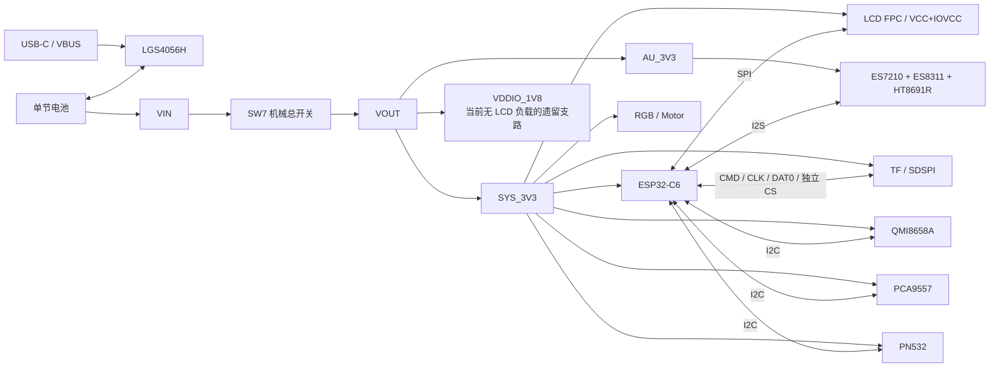

# YaKa 3.0 原理图综合审计与整改建议

> **当前状态（2026-10-21）：** 已从重新加载后的 EasyEDA 活体工程复核。新 ERM `LCM0720A3176F/C2942347` 已改为正确两脚符号，`1/+→SYS_3V3`、`2/-→Q9/$5N7`，并与 PCB 两焊盘、器件身份及装配属性一致；原理图与 PCB 292/292 器件及全部 pin/pad 端点为 0 差异，PCB 原生 DRC 为 0。当前未发现阻断首板功能的原理图 P0。电池充电器可以自治充电、终止和再充，但 MCU 仍不能读取完整充电状态；这是 Owner 已接受的首板能力边界，后续须同步收窄 PRD 表述，不再作为工程师硬件 ECO。

> 项目：`YaKa v3.0`  
> 文档版本：`R1.23`  
> 审计日期：2026-10-08；原理图变更复核：2026-10-12；最新版全量回归复核：2026-10-21  
> 补充证据：工程师修改说明 V1.1、2026-10-12 EasyEDA Pro 活体原理图与 PCB 一致性复查及 LCD 电平域在线整改回读、`H0160S002 V1` LCD 规格书、`303260-650mAh` 电池规格书、正反面 3D 装配图与精确器件资料  
> 实现基线：2026-10-21 EasyEDA Pro 活体原理图与绑定 PCB；当前生产 BOM：`.easyeda/artifacts/20261021-033234-schematic_bom-d133a614.csv`，SHA-256 `9efc5bc380f96df00a22d4390fb4b3244848e9089b5bf6b990dcd79aab920d3e`  
> 项目 UUID：`8f58125ad0d64436afbfeeeb03d3b159`  
> 原理图 UUID：`23291d2ced634dd6`  
> 绑定 PCB UUID：`db0afd3e4013441a9add6d64b7979887`  
> 审计对象：MCU、CODEC、POWER、MOT\|QMI\|SD\|LCD、PN532、SYSTEM 六页原理图，关键 BOM 与硬件—固件接口  
> 审计边界：本报告不评价 PCB 布局、走线、叠层、天线净空、NFC 线圈、声学结构、散热或 DFM；上述项目应在原理图整改完成并重新同步 PCB 后进入独立 G5 审计。

## 1. 签核结论

YaKa 3.0 的总体硬件架构已经覆盖 ESP32-C6、Wi-Fi、双麦克风、扬声器、TF、LCD、NFC、IMU、振动、RGB、USB-C 充电与串口下载。本轮只把“功能能否跑起来”作为当前硬门槛；寿命优化、极端浪涌、命名、几何清理和深度功耗分析不再混入本轮必改项。

### 1.1 当前执行状态

以下状态来自 2026-10-12 EasyEDA 活体原理图回读，不以聊天记录或修改说明代替实际网络。

| 状态 | 数量 | 当前内容 | 后续动作 |
|-|-:|-|-|
| P0，必须修复原理图 | **0** | 无 | 原理图功能门禁已关闭 |
| 已关闭的功能 P0 | 12 类 | 启动上拉、PN532 模式、RF ESD、充电 TEMP、TF CS、LCD CS、`PWR_SW_DET`、Flash 容量、RF BOM 身份、RGB 时序源与器件映射、LCD 电平域 | 不再要求工程师重复修改；只保留对应 EVT 或 PCB 同步验证 |
| P1，首板验证/条件接受 | 11 类 | SW7 额定、软电源可选链路、LCD 背光、电池负载、充电、Flash、TF、LCD 机械、音频、音频地、RF 实测匹配 | 不进入本轮工程师必改表 |
| P2，发布质量 | 2 组 | 闲置 1.8 V 支路；少量命名、DNP 和图面清理 | 功能闭环后一次性处理 |
| PCB 同步 | 已完成 | 292/292 器件、精确料号、装配属性与全部引脚/焊盘网络端点一致；PCB 原生 DRC=0 | 不再执行原理图导入；转入生产文件导出与 EVT |

> **当前结论：** C22 已由原理图/PCB 双侧 DNP 关闭；原 LRA 已替换为适配现有低侧开关拓扑的 3 V ERM，且原理图、PCB 和 BOM 已同步。充电状态可观测性按 Owner 决策作为产品能力边界处理。历史中间结论只用于追溯，不再作为执行项。

### 1.2 本轮 ECO 关闭表

本轮没有剩余的原理图功能 P0。下表保留最后一项 RGB ECO 的关闭证据，避免工程师重复修改。

| 状态 | 页面/对象 | 当前实现 | 关闭证据 |
|-|-|-|-|
| 已关闭 | MCU/POWER / LED1、LED3-LED7 | 六颗均为 `WS2812B-2020-V6/C52917434` 和新封装；符号已原地旋转修复，不重画导线 | 6/6 活体端点通过：pin 4=`SYS_3V3`、pin 2=`GND`；LED1 pin 3=`RGB`；五灯链为 `FIVE-RGB→LED7.DI→LED6→LED5→LED4→LED3`；两页保存成功；原生 DRC 为 0 error / 0 fatal，LED1/LED3 仅保留链尾 DO 悬空警告 |

LCD 电平域已由本轮在线原理图修改关闭：FPC1 pin 3 现接 `SYS_3V3`。U8/C32/C33 与 `VDDIO_1V8` 支路仍保留但已无 LCD 负载；这属于后续 BOM/功耗清理，不再是功能 P0，也不要求为了“图面整洁”扩大本轮电气修改。

GPIO15 是 JTAG strap，但在 ESP32-C6 默认 eFuse 组合下不参与 JTAG 源选择。采用 GPIO15 作 TF CS 时仍须保留上拉，并在任何 eFuse 策略变化后复核启动与调试行为。

### 1.3 已冻结结论：无需工程师重新决策

| 事项 | 已冻结结论 |
|-|-|
| 产品核心 | AI 语音对话与 TF 本地录音均为 Must；NFC 为辅助只读入口 |
| TF 接口 | ESP32-C6 无 SDMMC Host；本版统一采用 SDSPI，LCD 与 TF 必须使用独立 CS |
| 总开关 | 按 Owner 最新说明，SW7/`MASTER_SW` 就是正常开启/关闭整机电源的机械总开关；软按键电源链路不是首板基本功能前提 |
| 主控 | U1 为无后缀 `ESP32-C6` QFN-40；不改成 FH4/FH8 |
| Flash | U4 已为 16 MiB `PY25Q128HA-SSH-IR`；正式固件按 16 MiB 硬件适配 |
| 电池 | 已由供应商规格书确认为 `303260-650mAh`、标称 3.7 V、充电限制 4.25 V、最大持续充放电 650 mA、两线带保护板；不再沿用 `283260/700mAh` 图片推测 |
| 充电电流 | U5 为 4.2 V `LGS4056HDA`，R19=5.1 kΩ，按原厂低电流档约 176 mA（约 0.27C）；电流额定安全，但 4.2 V 终止会少用部分 4.25 V 电芯容量 |
| 硬件—固件关系 | 硬件先保证功能、电平、时序和引脚资源成立；后续固件按最终签核硬件灵活适配 |
| NFC/IMU IRQ | 当前版本允许轮询，不要求本轮新增 IRQ；功耗和响应在 EVT 验证 |
| RGB | 两组数据由 ESP32-C6 直连；六颗已换为明确支持 3.3 V 的 `WS2812B-2020-V6/C52917434`，器件身份、封装和端点映射均已关闭 |

### 1.4 非本轮工程师任务

| 项目 | 当前边界 | 后续处理 |
|-|-|-|
| SW7 量产资格 | 当前 50 mA 料号可用于首板功能验证，但额定裕量不足 | 首板测压降、发热和复位；量产前再决定是否换同结构更高额定开关，不要求本轮增加功率级 |
| 电池线束/量产收口 | 规格书只给出红黑 UL1571 40AWG，未给出线长、板端配套壳体、端子压接和量产极性检验 | 保持两线电池/TEMP 接地基线；冻结线束图、配套壳体、线长、极性与拉力要求 |

### 1.5 LCD 机械规格基线

Owner 于 2026-10-11 指定华夏彩外观尺寸图作为当前机械标准；本轮收到的 `H0160S002 V1` 原厂规格书与该图一致，因此机械基线由“暂行”提升为“规格书基线”。归档见 [LCD 机械尺寸图](assets/lcd-h0160s002-mechanical-drawing.jpg) 与 [LCD 完整规格书](assets/specs/lcd-h0160s002-v1-spec.pdf)。

| 项目 | 规格书基线 |
|-|-|
| 屏体 BL 外形 | 23.4 ± 0.15 mm × 38.5 ± 0.15 mm |
| LCD 外形 | 23.2 mm × 38.2 mm |
| 有效显示区 A.A | 21.36 mm × 33.79 mm |
| 模组厚度 | 1.51 ± 0.15 mm |
| 屏体下缘至 FPC 尾端 | 41.81 ± 0.5 mm |
| FPC 尾端宽度 | 8.2 ± 0.3 mm |
| FPC 厚度 | 0.30 ± 0.03 mm |
| FPC 尾端加固段 | 3.2 ± 0.3 mm |

完整规格书已经补齐屏体外形、FPC 厚度、12Pin pinout、逻辑电平和背光额定参数；仍未证明的是接触面方向、最小动态弯折半径和整机装配余量。当前连接器标称适配 0.3 mm FPC，厚度方向一致；G5 仍须核对槽口至 ZIF 的实际中心线路径、插入余量、防割伤圆角和装配公差。历史 PCB 白框约 23.4 × 38.5 mm，与屏体 BL 标称外形几乎相等，因此白框只能暂作放置基准，不能直接视为已经包含结构间隙。

## 2. 审计基线与判定方法

### 2.1 设计基线

| 项目 | 基线信息 |
|-|-|
| EasyEDA Pro | `V4.1.71`（当前在线编辑环境；工程数据源自 YaKa v3.0） |
| 原理图页 | MCU、CODEC、POWER、MOT\|QMI\|SD\|LCD、PN532、SYSTEM |
| 关键跨页网络 | `TF_SPI_CS` 已形成 J1 pin 2↔U1 GPIO15；`IO21_LCD_CS` 已形成 FPC1 pin 8↔U3 IO6；两路片选相互独立，原片选缺失已关闭 |
| 主控 | 无后缀 `ESP32-C6` 裸片，QFN-40 5 mm × 5 mm、无封装内 Flash，LCSC `C5364646`；硅片 revision 待实物读回（如需冻结） |
| 外置 Flash | 已改为 PUYA `PY25Q128HA-SSH-IR` / LCSC `C49242385`，128 Mbit / 16 MiB、SOP-8 150 mil；硬件连接成立，模式与可靠性待实板验证 |
| 音频 | ES7210 + ES8311 + HT8691R，双麦克风 |
| 显示接口 | 华夏彩 `H0160S002 V1`，1.6 英寸、200×320、ST7789、4SPI、12Pin；0.5 mm ZIF 连接器 LCSC `C5213732`；屏体 23.4 ± 0.15 mm × 38.5 ± 0.15 mm、厚度 1.51 ± 0.15 mm、FPC 厚度 0.30 ± 0.03 mm |
| 本地存储 | TF/microSD 卡座 |
| NFC | PN532，设计意图为 I²C |
| IMU | QMI8658A |
| 充电 | `C5124109` / LGS4056HDA，单节 4.2 V 充电终止版本 |
| 电池 | `303260-650mAh` 两线保护电池；3.7 V、650 mAh、充电限制 4.25 V、最大持续充放电 650 mA、包络约 3 ± 0.5 × 32 ± 0.5 × 60 ± 0.5 mm |
| 当前产品约束 | AI 语音对话与 TF 本地录音为双核心；NFC 首发只读；SW7 为正常开启/关闭整机的机械总开关 |

### 2.2 证据等级

本报告按以下顺序采用证据：

1. EasyEDA 活体器件、引脚、网络、Board 绑定与 BOM；
2. 精确器件的制造商数据手册、硬件设计指南、参考设计与 Errata；
3. 官方 SDK、驱动、接口文档和开发板资料；
4. 经授权的采购、装配和供应商记录；
5. 历史需求与沟通记录，仅用于解释设计意图，不覆盖当前实现。

### 2.3 严重度

| 等级 | 定义 |
|-|-|
| P0 | 核心功能确定失效、违反明确器件约束、制造定义不唯一，或阻断原理图签核 |
| P1 | 存在显著可靠性、功耗、保护、量产或功能风险；投板前必须整改、验证或书面接受 |
| P2 | 不直接阻断功能，但影响可维护性、可审计性、测试效率或发布质量 |

## 3. 系统架构与关键链路

主要依赖关系：

- `SYS_3V3` 同时承担 ESP32-C6、共享 I²C、TF、NFC、IMU、GPIO 扩展和反馈器件供电；
- ESP32-C6 与音频器件共享 I²S 时钟，播放与采集拓扑需由同一时钟和 slot 规划约束；
- PCA9557 当前连接 LCD 背光、复位、片选、数据/命令、马达和 `PWR_EN`；IO3/IO5 已 NC，不再承担 RGB 时序；软电源保持链路仍不成立，但按当前产品定义不阻断首板；
- TF 写入和 OTA 均依赖受控关机，SW7 直接硬切会绕过固件收尾；
- LCD 模组身份、pinout、供电域和背光约束已经由 `H0160S002 V1` 规格书冻结；FPC1 IOVCC 已改为 `SYS_3V3`，电平域实现现与该契约一致。

## 4. ESP32-C6 最小系统、启动与下载

### 4.1 `CHIP_PU` 与 `GPIO9` 上拉电源域（原 P0 已关闭，待实板验证）

2026-10-11 活体连接为：

- `U1.4 CHIP_PU → RESET → R13 → SYS_3V3`；
- `RESET → C21 → GND`；
- `U1.15 GPIO9 → IO9_BOOT → R10 → SYS_3V3`；
- `IO9_BOOT → C22 → GND`。

原审计中依赖 `VBUS` 的确定性错误已经消除，按原理图层面可将 `YAKA-SCH-P0-001` 标记为关闭。该结论不等于启动链路已通过 EVT：C21/C22 的实际值、DTR/RTS 自动下载网络、USB 插拔反灌和低电量启动仍须用波形与重复启动验证。

验收条件：电池、USB、低电量和 USB 热插拔场景分别完成冷启动统计；手动与自动下载均稳定；示波器记录 `SYS_3V3/CHIP_PU/GPIO9` 时序。

### 4.2 外置 Flash 与 OTA 容量（硬件连接通过，量产资格 P1）

U4 当前为 PUYA `PY25Q128HA-SSH-IR`（LCSC `C49242385`），容量 128 Mbit = 16 MiB、2.7–3.6 V、133 MHz、SOP-8 150 mil。活体引脚拓扑与 ESP32-C6 外置 SPI Flash 总线相符，封装保持当前空间约束，硬件容量与连接成立。

硬件不受任何早期固件配置限制。正式固件应按最终签核硬件重新生成 pinmux、Flash 容量和分区表。

剩余风险是器件资格而非容量不足：ESP-IDF 已发布的默认 QIO/QOUT 厂商集合未明确列出 PUYA。首板应以 DIO 为保守基线，通过 `esptool flash-id`、全片擦写/读回、冷热/低压、OTA/回滚、Secure Boot/Flash Encryption（如启用）及 QIO 专项测试后再冻结量产模式。该验证属于 P1。

若可接受改为 SOP-8 208 mil 并且活体 PCB 空间复核通过，可把 ESP-IDF 默认 QIO 支持厂商的 `GD25Q128ESIGR`（LCSC `C2928891`）作为低软件风险备选；它不是当前 150 mil 封装的原位替换。

### 4.3 RF 馈线保护器件（原 P0 已关闭，RF 验证仍为 P1）

D2 已改为 Littelfuse `PESD0402-240` / LCSC `C1975527`，0402 双向器件，典型电容 0.25 pF，制造商明确面向高频天线、蜂窝、GPS 和 Bluetooth 等应用。原 `SMF24CA` 作为通用 24 V TVS 并联射频馈线的确定性选型错误已关闭。

该器件的 24 V 反向工作电压不能被误读为电源轨保护等级；原厂资料明确不应用于 Power Bus。D2 的剩余验收属于射频系统验证：保留可调 π 匹配位，并在实际 PCB、外壳、电池与装配状态下执行 VNA、S11、发射功率、接收灵敏度和吞吐 A/B 测试。

## 5. 电源、充电与关机链路

### 5.1 SW7 主电流额定与硬切行为（P1，不阻断首板功能）

SW7 不是普通信号按键，而是串在 `VIN→VOUT` 上的机械滑动总开关；ON 时整机电流都会经过其触点。机械开关直接串联主电源是正常架构，前提是触点持续载流、带载通断与寿命额定覆盖实际负载。当前精确料号 `MSK12C02/C431540` 标称 50 mA，而整机工作电流可能高于 50 mA，因此问题是现有料号超出额定使用，不是“主电源不能串机械开关”。

但“超出额定”不等于“样机一定无法开机”。开关很可能在首板阶段仍能导通，主要风险是长期接触电阻增大、压降和寿命，而不是确定性的当前功能失效。按本项目“先让完整功能跑起来”的目标，本项降为 P1，不再阻断本轮原理图功能闭环。

Owner 最新说明把 SW7 定义为正常开启/关闭整机电源的机械总开关。按这一产品定义，SW7 能直接完成基本开关机；录音、TF 写入或 OTA 期间硬断电的数据一致性属于固件与 EVT 恢复验证，不再作为要求硬件工程师修改 SW7 或实现复杂软电源架构的独立原理图问题。

Owner 补充的正面 3D 装配图确认：SW7 位于左侧板边，采用侧拨操作，拨杆伸出板外，图示 ON 在上、OFF 在下。该证据可以冻结当前交互位置和方向，但不能证明本体、焊盘、拨杆高度/行程和壳体开口的精确尺寸。背面 3D 图同时显示另一面已有 USB-C、充电/电源器件、LCD FPC、音频/NFC/马达连接及结构占位，不能仅凭渲染图假定 SW7 对面存在可直接使用的器件空间。归档见 [正面/SW7 3D 装配图](assets/sw7-board-edge-placement-3d.png) 与 [背面 3D 装配图](assets/board-back-placement-3d.png)。

首板处理保持简单：暂不为 SW7 单独重构电源；样机在 Wi-Fi+音频等正常高负载下检查开关两端是否出现明显压降、异常发热或随机复位。若没有异常，首板继续使用；量产前再决定是否换大电流同结构开关。

### 5.2 LGS4056H `TEMP`（原 P0 已关闭）

U5.1 `TEMP` 已通过新增 R89=0 Ω 接地，符合两线电池且不使用 NTC 温度检测时的数据手册要求。原悬空问题已在原理图层面关闭。

供应商规格书现已确认电池为 `303260-650mAh`：标称 3.7 V，充电限制 4.25 V（规格书标注 +0.03/-0.02 V），最大持续充电和放电均为 1C=650 mA，充电温度 0-45 ℃、放电温度 -20-60 ℃；包内有保护板但仍只有红黑两线，没有 NTC。此前依据商品图推测的 `283260/700mAh` 结论作废。

U5 为 4.2 V `LGS4056HDA`，R19=5.1 kΩ。按原厂低于 300 mA 的设定关系和 9 kΩ=100 mA 示例，当前恒流充电约 176 mA，即约 0.27C，低于电池 650 mA 最大持续充电额定；充电终止电流约为 1/10 ICC≈17.6 mA，略高于电池规格的 0.02C=13 mA。4.2 V 恒压低于电池 4.25 V 限制电压，不构成过充，但会少用部分额定容量。电池保护板过充阈值表给出 4.20/4.25/4.255 V，与充电器 4.20 V 标称边界贴近且表格自身存在公差表达疑点，应在样品完整充电周期中确认不会发生保护板先动作、充电反复重启或异常终止。

采用 TEMP 接地方案时，不得把充电芯片自身结温调节表述为电芯温度监测。如未来要求电芯温度保护，应改用带 NTC 的三线电池包或建立与电芯可靠热耦合的外置 NTC。

### 5.3 电池持续放电（P1，样机验证）

电池规格书确认最大持续放电为650 mA，但当前没有证据证明正常产品场景一定超出该值，因此不再把它作为工程师必须改图的 P0，也不要求建立复杂浪涌模型。

首板只做直接验证：在 Wi-Fi 对话播放、录音写 TF、屏幕正常亮度等真实使用场景运行，观察是否出现复位、明显音频失真、电池/连接器异常发热或电压快速跌落。只有实际出现问题，或实测持续电流明显超过650 mA，才升级电池或限制高功耗功能。

### 5.4 `PWR_SW_DET` 危险支路（原 P0 已关闭）

本轮活体复核确认：R87、R88 已从 POWER 页删除；SW7 pin 3 现为 NC；GPIO15 不再连接 `PWR_SW_DET`，而改作独立 `TF_SPI_CS`。满电池电压进入 GPIO、失电域反向供电和约 4.7 mA 关机支路电流三类风险已在原理图层面关闭。

该关闭不改变 SW7 仍为 50 mA 主电流开关的问题，也不证明 PCB 已同步。G5 前必须用原理图—PCB变更预览确认旧 R87/R88、旧网络和铜线均已从 PCB 移除。

### 5.5 软启动与电源保持二极管 OR 方向（P1，可选功能）

Q1（AO3401A）构成 VIN→VOUT 的高侧保持通路，Q2 拉低 Q1 栅极，`SW_EN` 经 R21 驱动 Q2。KEYA、KEYB 与 PCA9557 `PWR_EN` 原本应通过二极管 OR 向 `SW_EN` 提供启动和保持信号。

活体连接中 D5-D8 的方向确实无法让按键或 `PWR_EN` 驱动 `SW_EN`，所以这套软启动/保持功能按当前图不能工作。但 Owner 最新定义允许 SW7 直接作为正常电源开关，因此它不再阻断基本开关机和首板功能。

本轮可不修改该支路。若后续仍希望实现按键开机、固件保持或软关机，再把它作为独立功能 ECO 修正；若确定永远只使用 SW7 硬开关，则可删除无效软电源支路，避免留下误导性电路。

## 6. TF 本地存储

### 6.1 SDSPI 主机接口（原 P0 已关闭，保留 P1 验证）

本轮活体 J1 连接为：

- `CMD → GPIO18`；
- `CLK → GPIO19`；
- `DAT0 → GPIO20`；
- `DAT3/#CS → TF_SPI_CS → GPIO15`，并保留 51 kΩ 上拉与 D14 ESD。

ESP32-C6 不提供 SDMMC Host，本项目应使用 SDSPI；当前 CMD/CLK/DAT0/DAT3 已可分别映射 MOSI/SCLK/MISO/CS，且 TF 与 LCD 使用独立片选。原缺失 CS 的确定性功能缺陷已经关闭。

GPIO15 是 JTAG strap，51 kΩ 上拉在当前电路中不会主动拉低启动脚，但仍应在最终 eFuse/JTAG 策略、卡插入/拔出和不同卡上电行为下验证启动。卡座机械 CD 脚仍未连接，固件只能通过协议/轮询判断卡状态；这不阻断录音，但必须定义拔卡和坏卡恢复行为。

验证至少覆盖多厂牌/容量卡、格式化、挂载、连续录音、并发访问、存储满、拔卡、坏卡、低电量和写入时随机断电恢复。

## 7. LCD 与 GPIO 扩展

### 7.1 LCD 原厂接口契约与 I/O 电平域（原 P0 已关闭）

FPC1 可确认是 12Pin、0.5 mm ZIF 连接器 `HC-FPC-05-10-12RLTAG.1`，当前网络为：

| Pin | 原厂功能 | 当前网络 | 判定 |
|-:|-|-|-|
| 1 | VCC | `SYS_3V3` | 在 2.4-3.3 V 范围内 |
| 2 | GND | `GND` | 通过 |
| 3 | IOVCC | `SYS_3V3` | 已与控制输入统一为 3.3 V 域 |
| 4 | GND | `GND` | 通过 |
| 5 | LEDA | `SYS_3V3` | 背光压差不足，见 7.3 |
| 6 | LEDK | `LEDK→R84 10 Ω→Q10` | 非恒流，见 7.3 |
| 7 | RESET | `LCD_RST` / U3 IO1 | 3.3 V 域，通过 |
| 8 | CS | `IO21_LCD_CS` / U3 IO6 | 片选已连通；3.3 V 域，通过 |
| 9 | SDA（串行数据） | `IO6_LCD_CLK` / U1 GPIO6 | 电气可用，但功能名写反 |
| 10 | SCL（串行时钟） | `IO7_LCD_DIN` / U1 GPIO7 | 电气可用，但功能名写反 |
| 11 | TE（输出） | NC | 原厂允许不用时悬空 |
| 12 | DC | `LCD_DC` / U3 IO7 | 3.3 V 域，通过 |

`H0160S002 V1` 原厂规格冻结了 12Pin pinout、VCC/IOVCC 范围和数字电平：IOVCC 允许 1.65-3.3 V，逻辑输入绝对最大值为 `IOVDD+0.3 V`，VIH 最低为 `0.7×IOVDD`。旧实现 IOVCC=1.8 V 时，五路 3.3 V 控制输入属于确定性越限。

2026-10-12 已通过 typed MCP 将 FPC1 pin 3 从 `VDDIO_1V8` 改接 `SYS_3V3`。执行过程先断开旧单端支路，再建立新的 `SYS_3V3` 连接；随后完成保存、关闭重载和再次回读，确认 FPC1 pin 1/3 均为 `SYS_3V3`，其余 FPC 端点未变化。原生 DRC 为 0 fatal、0 error；独立检查为 floating pin 0、几何网络不一致 0、网络标记不一致 0、多网络导线 0、零长度线 0、悬空线 0。该 P0 在原理图层面关闭。

U8/C32/C33 与 `VDDIO_1V8` 支路仍存在，但已不再连接 LCD。删除或 DNP 它们属于后续 BOM/功耗清理；是否将 C32/C33 迁移为 FPC1 pin 3 的就近去耦，应结合 PCB 实际位置处理。该清理不影响本次电平域关闭结论，也不要求为了封版整洁临时扩大电气改动。

pin 9/10 不构成功能 P0，因为 GPIO6、GPIO7 均可由后续固件灵活定义为数据或时钟；不需要为此交换 PCB 铜线。为避免工程师和固件继续被误导，应把 pin 9 恢复标注为 `SDA/LCD_DIN`、网络改名 `IO6_LCD_DIN`，把 pin 10 恢复标注为 `SCL/LCD_CLK`、网络改名 `IO7_LCD_CLK`。这是 P2 契约修正，不能再沿用当前反向文字。

规格书自身还有两处非原理图 P0 的资料冲突：概览页给出工作温度 -20~70 ℃，绝对最大额定页给出 -20~60 ℃；供应商澄清前按更严格的 -20~60 ℃ 设计。初始化代码章节为空，后续固件需取得供应商初始化序列或用实物验证扫描方向、偏移、色序、Gamma、休眠/唤醒和电源时序，不能仅凭通用 ST7789 示例直接冻结量产参数。

### 7.2 LCD 独立片选（原 P0 已关闭）

本轮活体端点复核确认 `FPC1.8 CS ↔ IO21_LCD_CS ↔ U3.13 IO6`，TF 则独立使用 `TF_SPI_CS ↔ U1 GPIO15`。两个 SPI 从设备不再共用或缺失片选，原 P0 在原理图层面关闭。

U3 IO6 适合在事务边界控制 CS，但其上电默认态、初始化先后与 LCD 休眠/复位时序仍应在 EVT 复核。IOVCC 改为 3.3 V 后，如原厂要求上电保持 CS 高，应增加或确认合适的 3.3 V 上拉。

### 7.3 LCD 背光驱动余量（P1，先点亮验证）

原厂规格给出三颗白光 LED 并联、总额定电流 60 mA、正向压降 2.8-3.3 V，并明确建议采用恒流电路。当前实现为 LEDA 直接接 `SYS_3V3`，LEDK 经过 R84=10 Ω 和 Q10 低边开关到地。忽略 MOSFET 压降时，总电流近似 `(3.3-Vf)/10 Ω`：Vf=2.8 V 时约 50 mA，Vf=3.0 V 时约 30 mA，Vf=3.3 V 时趋近 0。该方案既达不到标称 60 mA，也不能在允许的 LED 批次、温度和 3.3 V 轨误差下保证可见亮度。

该方案不保证在所有 LED Vf 分档下达到规格书额定亮度，但不等于样机一定无法显示。首板先验证正常电量和低电量下是否能稳定点亮、亮度是否满足产品使用；若亮度足够且无异常发热，本版可保留。只有出现明显偏暗、批次差异或不稳定时，再改恒流背光驱动。

### 7.4 GPIO 资源闭环状态

在不减少目标功能的前提下，推荐以下最小改动方案，最终仍需结合 PCB 走线和绑带复核：

| 资源 | 建议用途 | 约束 |
|-|-|-|
| GPIO15 | TF `DAT3/#CS` | 已实施；保留卡座 CS 上拉；GPIO15 是 JTAG strap，需验证启动和调试配置 |
| PCA9557 IO6 | LCD_CS | 已实施；IOVCC 改 3.3 V 后确认上电保持未选中 |
| GPIO21（U1 pin 34） | 五灯 WS2812 数据 | 已实施为 `FIVE-RGB`；使用 C6 RMT/等效硬件时序输出 |
| GPIO8 | 独立 WS2812 数据 | 已实施为 `RGB`；现有 10 kΩ 上拉可保留；GPIO8 是 strap，LED DI 必须保持高阻并验证启动组合 |
| PCA9557 IO7 | LCD_DC | 保持现有硬件定义；按 LCD 电平域决定是否转换 |

TF 独立片选、LCD CS、`PWR_SW_DET` 占脚、两组 RGB 数据迁移和 LCD 电平域整改均已实施；U3 IO3/IO5 已 NC。当前 GPIO 分配在原理图层面闭合，剩余原理图 P0 只有 RGB 精确灯珠，其他事项进入实板启动/时序验证。

## 8. NFC、IMU 与共享 I²C

### 8.1 PN532 接口模式（原 P0 已关闭）

U13 当前为 `I0/SET0 → R73 → GND`、`I1/SET1 → R74 → SYS_3V3`，即 `I1:I0=10`，与 U13.27/28 所接共享 I²C `IO11_I2C_SCL/IO10_I2C_SDA` 一致。原 HSU 绑带与 I²C 接线冲突已在原理图层面关闭。

验收：读取 PN532 固件版本；连续读取指定标签；覆盖无卡、未知卡、超时、休眠/唤醒和共享总线异常恢复。

### 8.2 PN532 IRQ 与生命周期（P2/条件接受）

PN532 IRQ 未连接 MCU，只能采用轮询。轮询方案需通过功耗与响应延迟验证。PN532 已被 NXP 标记为 Not Recommended for New Designs；当前版本可保留并完成验证，但后续硬件代际应评估在产替代器件，不宜在本次整改中无依据换芯。

### 8.3 QMI8658A 地址与中断（P2/条件接受）

QMI8658A `SA0` 已通过 R90=0 Ω 固定到 GND，7-bit 地址确定为 `0x6A`，原地址浮空不确定性已关闭。INT1/INT2 均明确 NC，现方案只能轮询。

当前 IMU 动作交互已被降为 Could，轮询可以实现基本功能，因此不作为原理图 P1 阻断。若未来把低功耗动作唤醒提升为 Must，才需要补充中断连接；本版仍应记录轮询功耗、延迟和误触结果。

### 8.4 I²C 地址与上拉

共享 I²C 连接 ESP32-C6、PCA9557、ES8311、ES7210、PN532 和 QMI8658A，R11/R12 上拉至 `SYS_3V3`。当前推导地址如下：

| 器件 | 7-bit 地址 | 判定 |
|-|-|-|
| PCA9557 | `0x19` | 已由 A0/A1/A2 确定 |
| ES8311 | `0x18` | 高置信，仍需实板 probe |
| ES7210 | `0x41` | 已由 AD0/AD1 确定 |
| QMI8658A | `0x6A` | SA0 已由 R90=0 Ω 固定到 GND |
| PN532 | 无地址冲突 | 已固定为 I²C 模式，待实板 probe |

未发现地址冲突。仍需按器件输入电容、布线和目标速率核算总线上拉与上升时间。

## 9. 音频、马达与反馈器件

### 9.1 音频拓扑（P1）

ES7210、ES8311 和 HT8691R 形成双麦采集与扬声器播放链路。当前共享 `MCLK=GPIO0`、`BCLK=GPIO3`、`WS=GPIO12`；ES8311 播放数据由 `GPIO1` 输出，ES7210 采集数据经 R65 接 `GPIO13`。拓扑具备实现基础，但以下项目未冻结：

- I²S 主从关系、采样率、位宽和 slot；
- 双麦通道顺序与 TDM 配置；
- R66 已设为真实 DNP，并从当前生产 BOM 排除；该装配歧义已关闭；
- MIC3 作为播放参考/AEC 的装配和算法路径；
- 功放使能时序、上电爆音、满双工串音和底噪。

建议以精确器件数据手册和 Espressif 官方 codec 驱动为基础，形成唯一音频接口契约，并执行单独录音、单独播放、满双工、Wi-Fi 并发、底噪、频响和声学回声测试。

### 9.2 音频地（P1）

`AU_GND` 与系统 `GND` 通过 R60=0 Ω 单点桥接；R60 的装配值已明确，原理图歧义关闭。桥接位置、功放大电流回路、麦克风回流与数字跨区路径是否合理仍只能在 G5 结合 PCB 判断。

### 9.3 RGB 器件资格与引脚—网络映射（已关闭）

系统包含五颗串联可寻址 RGB 和一颗独立可寻址 RGB。PCA9557 IO3/IO5 已明确 NC，两路时序源仍由 ESP32-C6 直接驱动，因此此前的时序源缺陷保持关闭。

2026-10-12 Owner 手工把六颗灯更换为 Worldsemi `WS2812B-2020-V6` / LCSC `C52917434`，绑定封装为 `LED-SMD_4P-L2.2-W2.0-P1.00_WS2815C-2020-4P`。旧 `C965555` 的精确数据手册规定 3.7–5.3 V、额定 5 V，因此 3.3 V 下可能点亮但不属于保证工况；V6 的原厂规格明确覆盖 3.3–5.5 V，故器件供电资格问题关闭。

首次替换后目标库符号的左右脚位置与旧符号相反，导线坐标未同步，曾短暂形成 VDD/GND 与 DI/DO 错配。随后通过 typed MCP 将六颗新符号各自原地旋转 180°，未重画导线、未更改网络、未改位号或唯一 ID。保存 MCU/POWER 页后重新读取活体端点，六颗全部符合下表契约：

| 实例 | pin 3 / DI | pin 1 / DO | pin 4 / VDD | pin 2 / GND |
|-|-|-|-|-|
| LED1 | `RGB` | 末端悬空或显式 NC | `SYS_3V3` | `GND` |
| LED7 | `FIVE-RGB` | 接 LED6 pin 3 | `SYS_3V3` | `GND` |
| LED6 | 接 LED7 pin 1 | 接 LED5 pin 3 | `SYS_3V3` | `GND` |
| LED5 | 接 LED6 pin 1 | 接 LED4 pin 3 | `SYS_3V3` | `GND` |
| LED4 | 接 LED5 pin 1 | 接 LED3 pin 3 | `SYS_3V3` | `GND` |
| LED3 | 接 LED4 pin 1 | 末端悬空或显式 NC | `SYS_3V3` | `GND` |

闭环证据：六颗均为 `C52917434`，6/6 端点回读通过；两页保存成功；原生原理图 DRC 为 0 fatal、0 error、14 warning。与 RGB 相关的两项 warning 仅为 LED1/LED3 链尾 DO 未连接，符合当前拓扑；若需要发布图面零歧义，可后续补显式 NC，不属于功能缺陷。

旧件与 V6 的官方机械图均为约 2.20×2.00 mm 本体、相同 1/2/3/4 引脚定义及相同量级的 2020 推荐焊盘。库封装名称虽然由 `L2.0-W2.0` 变为 `L2.2-W2.0`，但不能据名称推断需要重新布线；PCB 同步时仍须在原生变更预览中逐项比较焊盘中心、尺寸、极性和 courtyard。

## 10. BOM、装配定义与原理图质量

### 10.1 RF 匹配网络数值复核（BOM 身份已关闭，性能为 P1）

2026-10-12 活体端点确认 RF 链路由两级可调网络组成，拓扑与 Espressif 建议的“芯片侧 CLCCL + 天线侧 CLC”一致：

`U1 ANT → C15(对地) → L5(串联) → C14(对地) → C16(串联) → L1/C13(对地) → L4(串联) → C12/D2(对地) → L3 天线`

| 功能位置 | 位号 | 当前值与精确料号 | 封装 |
|-|-|-|-|
| 芯片侧 CLCCL | C15、C14、C16 | 3.3 pF，`GJM1555C1H3R3WB01D/C88892` | 0402 |
| 芯片侧 CLCCL | L5、L1 | 1.5 nH，`LQG15HS1N5S02D/C77106` | 0402 |
| 天线侧 CLC | C13、C12 | 4.7 pF，`GJM1555C1H4R7BB01D/C161327` | 0402 |
| 天线侧 CLC | L4 | 1.8 nH，`LQG15HS1N8S02D/C77107` | 0402 |
| 天线端 ESD | D2 | `PESD0402-240/C1975527`，典型电容 0.25 pF | 0402 |
| 天线 | L3 | `C411566`，规格书标称 50 Ω、2.4–2.4835 GHz | 3.1 × 1.6 mm |

在 2.45 GHz，理想元件电抗为：3.3 pF 约 `−j19.7 Ω`，4.7 pF 约 `−j13.8 Ω`，1.5 nH 约 `+j23.1 Ω`，1.8 nH 约 `+j27.7 Ω`；D2 的 0.25 pF 约为 `−j260 Ω`。这些量级与 2.4 GHz 小型匹配网络相符，没有出现数量级错误、直流短路或明显不可能的元件值。

为解释此前出现的“85.7%”，本轮重新建立了可复现的理想网络模型：芯片源阻抗取 Espressif 调试目标的 35 Ω，天线取纯 50 Ω，L/C 无损，计入 D2 典型 0.25 pF，但不计 PCB 传输线、器件 Q/S 参数、天线复阻抗相位、屏幕、电池和外壳失谐。结果如下：

计算方法为从 50 Ω 负载反推完整梯形网络输入阻抗 `Zin`，再按无损网络的失配功率传递率 `η = 4·Rs·Re(Zin) / |Rs + Zin|²` 计算，其中 `Rs=35 Ω`。该定义只衡量此理想模型的阻抗失配，不包含导体、介质、器件 Q、走线和天线辐射损耗。

| 频率 | 理论功率传递率 | 等效失配损耗 | 模型意义 |
|-:|-:|-:|-|
| 2.400 GHz | 90.37% | 0.440 dB | 理想低频带边缘 |
| 2.450 GHz | **85.74%** | 0.668 dB | “85.7%”的可复现来源 |
| 2.4835 GHz | 81.56% | 0.885 dB | 理想高频带边缘 |

同一理想模型在 2.45 GHz 看到的网络输入阻抗约为 `26.6−j23.4 Ω`，并非目标 `35+j0 Ω`；相对于 35 Ω 源的等效回波损耗约 8.46 dB。完整无损网络在 4.8 GHz、7.2 GHz 的理论 S21 分别约为 −43.9 dB、−65.7 dB，说明谐波抑制拓扑有效，但不能证明实板基波已经匹配。

因此结论分为两层：

- **高置信：** RF 拓扑成立，当前 Value、MPN、LCSC C号和封装已经一致；“料号绑定错误”保持关闭。
- **中等置信：** 当前值可以作为首板装配和 VNA 调试起点，未发现必须在投首板前盲改的数值错误。
- **未知：** YaKa 实板的最终 S11、效率、发射功率和接收灵敏度。天线规格书的 −17 dB/−20.2 dB 数据仅适用于其规定的 0.8 mm 测试板与净空，且没有给出复阻抗相位，不能直接代入 YaKa 整机。

Espressif 明确说明匹配值随 PCB 改变，最新指南推荐芯片侧采用 0201，而现图为 0402；这不是首板 P0，但会增加寄生和调试偏差。当前不改数值，保留全部调谐位。原理图同步 PCB 后，应在装入实际屏幕、电池和外壳的状态下用 VNA 测量：2.4–2.4835 GHz 以端产品 `S11 ≤ −10 dB` 作为早期目标，并同时验证吞吐、接收灵敏度、发射功率和 EVM；若不达标，再根据 Smith 图调整 C/L，而不是依据理想计算盲换固定值。

### 10.2 原理图—PCB 一致性（2026-10-12 历史快照；已由 2026-10-14 复核取代）

> 本节保留原始同步前证据，仅用于追溯，不再描述当前 PCB。当前状态见 [YaKa 3.0 PCB 综合审计与整改执行规范](yaka-3.0-pcb-comprehensive-audit-and-eco-spec.md) R1.4：全部已批准 ECO 已落板，292/292 器件与引脚端点一致，PCB 原生 DRC=0。

2026-10-12 对绑定 PCB UUID `db0afd3e4013441a9add6d64b7979887` 的活体器件回读表明，工程师修改已经进入原理图，但尚未导入 PCB。原生 PCB DRC 同时明确返回 1 项 `Netlist Error / Import Changes`，提示 PCB 与原理图网表不一致。该问题不推翻原理图功能修复结论，但在同步完成并审阅变更前禁止把当前 PCB 作为制造基线。

| 对象 | 原理图活体状态 | PCB 活体状态 | 判定 |
|-|-|-|-|
| U4 Flash | `PY25Q128HA-SSH-IR`，16 MiB | `W25Q16JVSNIQ`，2 MiB | 未同步 |
| C14/C15/C16 | `GJM1555C1H3R3WB01D`，3.3 pF | `CL05A105KA5NQNC` | 未同步 |
| L1/L5、L4 | 分别为 1.5 nH、1.8 nH 精确料号 | 仍为旧 `MLG1005S2N0BT000` | 未同步 |
| 位号治理 | `MASTER_SW`、`PWR_A/PWR_B`、`DPAD_*`、`ACT_*` | 仍为 `SW7`、`KEYA/KEYB`、`SW1-SW6` | 未同步 |
| LCD 电平域 | FPC1 pin 3 已改接 `SYS_3V3`，原理图 P0 已关闭 | PCB 尚未导入该网络变化，仍保留 U8 支路 | 未同步；当前按 Owner 要求暂停导入 |
| RGB 灯珠 | 已为 `C52917434` 和新封装；六颗端点映射全部正确，原理图 P0 已关闭 | PCB 仍为 `C965555`，证明尚未导入本次替换 | 后续在原生变更预览中核对封装焊盘与极性，再统一同步 |

上述状态已被后续工程师导入和 2026-10-21 最新活体复核取代。历史 `Import Changes` 已清零；不得再把旧 2 MiB Flash、旧 RGB、旧 MOTOR 或旧位号当作当前 PCB 状态。

### 10.3 原理图表达与几何质量（P2）

2026-10-12 最新原生 DRC 为 0 fatal、0 error、14 warning，告警主要是 POWER 页离网格对象、全工程属性匹配提示，以及两颗 RGB 链尾 DO 的预期悬空提示。独立检查未发现由本轮 LCD/RGB 修改引入的功能性断网、多网络导线或网络标记不一致。

早期重建检查中的大量 crossing/orphan 记录混有合法跨页端口、无结点交叉和工具噪声，不再把总数作为工程问题反复追问。发布前只处理能够定位到具体对象、会误导连接或影响维护的零长度线、孤儿 stub、离网格对象和未显式 NC；其余纯图面提示不进入首板门禁。

### 10.4 ADC 按键梯形网络（P1）

按 3.3 V、4.7 kΩ 上拉计算，六个单键理论电压约为 0、0.323、0.668、1.049、1.383、1.795 V。单键间隔具备识别基础，但电阻容差、ADC 非线性、供电波动和多键同时按下会改变电压；多键组合不是唯一编码。

建议在最差电压、温度和器件容差下建立阈值窗口，实板采样形成校准数据；固件明确拒绝多键、设定优先级或定义有限组合，不得默认所有组合都可识别。

## 11. 风险清单与整改优先级

### 11.1 P0：原理图签核前必须关闭

当前无未关闭的原理图功能 P0。已关闭问题不再在风险表中重复展开；其对象、关闭证据和剩余验证统一保留在附录 A。PCB 已完成关键 ECO 同步，但仍须关闭独立 PCB 审计中的制造发布门禁后才能投板。

### 11.2 P1：不进入本轮必改表，首板或量产前按条件处理

| ID | 类别 | 模块 | 问题 | 处置要求 |
|-|-|-|-|-|
| `YAKA-SCH-P1-018` | 可选功能 | 软电源 | D5-D8 方向使按键启动/保持链路无效 | 当前由 SW7 正常硬开关机，不阻断首板；以后需要软开关时再修或删除无效支路 |
| `YAKA-SCH-P1-015` | 首板接受偏差/量产前确认 | SW7 | `MSK12C02/C431540` 的 50 mA 触点承载整机电流；不阻断首板，但料号额定缺少裕量 | 本轮不改原理图；正常高负载下检查压降、发热和复位，无异常则首板接受，量产前决定是否换高额定同结构开关 |
| `YAKA-SCH-P1-016` | 首板观察 | LCD 背光 | 3.3 V+10 Ω 不保证覆盖规格书全部 Vf 分档 | 验证正常/低电量亮度；满足使用即可保留，异常才改恒流驱动 |
| `YAKA-SCH-P1-017` | 首板观察 | 电池 | 650 mA 持续额定是否覆盖真实使用尚未实测 | 只测真实高负载场景；出现复位、明显掉压或过热才升级处理 |
| `YAKA-SCH-P1-013` | EVT/供应商确认 | 充电 | 4.2 V 充电器对 4.25 V 电池安全但会少用容量；保护板过充阈值最小值 4.20 V 与充电终止边界贴近 | 完整充电周期确认无保护板先动作、反复重启或异常终止；记录实际可用容量 |
| `YAKA-SCH-P1-014` | EVT | TF | CS 已补齐，但 GPIO15 strap、卡座无 CD、热插拔和写入掉电仍未验证 | 多卡挂载、冷启动、拔卡、坏卡、存储满和随机断电恢复 |
| `YAKA-SCH-P1-005` | G5 | LCD 机械 | 规格书尺寸已冻结；槽口路径、接触面、弯折与装配余量未实物验证 | 按第 1.5 节尺寸设计；G5 实测 FPC 穿槽路径、接触方向和装配余量 |
| `YAKA-SCH-P1-008` | EVT | 音频 | I²S/AEC 的主从、slot、增益与功放时序尚未经过首板实测；R66 DNP 已冻结 | 建立唯一音频契约并做录放、满双工、爆音、底噪和温升验证 |
| `YAKA-SCH-P1-009` | G5 | 音频地 | R60=0 Ω 已明确，PCB 回流路径仍未知 | G5 检查回流与桥接位置；本轮不要求仅凭原理图改动 |
| `YAKA-SCH-P1-010` | EVT 验证 | Flash | 16 MiB 连接成立，但 PUYA 的 DIO/QIO、低压、OTA 和安全功能未实板验证 | 以 DIO 起步并闭环 QIO/擦写/OTA/安全功能验证；正式固件按 16 MiB 重建 |
| `YAKA-SCH-P1-019` | G5 + EVT | Wi-Fi RF | 当前匹配值在理想 35 Ω→50 Ω 模型下 2.45 GHz 理论传递率 85.74%，但实板天线复阻抗、0402 寄生和整机失谐未知 | 当前值作为首板起点；整机状态 VNA 调至 2.4–2.4835 GHz 早期目标 `S11 ≤ −10 dB`，并验证吞吐、灵敏度、功率与 EVM |

### 11.3 P2：发布质量

#### `YAKA-SCH-P2-002`：闲置 LCD 1.8 V 支路清理

FPC1 已不再使用 `VDDIO_1V8`；U8/C32/C33 当前构成无 LCD 负载的遗留支路。可在后续原理图—PCB 同步前删除或设为 DNP；如 C32/C33 的 PCB 位置适合作为 FPC1 IOVCC 就近去耦，可改接 `SYS_3V3` 并保留。该项不影响硬件功能闭环，不得提升为当前 P0，也不得在未审阅 PCB 位置时机械全删。

#### `YAKA-SCH-P2-001`：按键、开关与歧义控制信号命名治理（器件位号已执行）

器件位号已经完成并通过保存、重载和回读；网络名和符号引脚名没有随位号 ECO 修改。后续 PCB 同步时应确认这些变化只表现为位号更新，不改变连接。

| 原位号/名称 | 当前名称或建议 | 状态 |
|-|-|-|
| `SW7` | `MASTER_SW` | 已完成 |
| `KEYA` / `KEYB` | `PWR_A` / `PWR_B` | 已完成 |
| `SW1`–`SW4` | `DPAD_UP/DOWN/LEFT/RIGHT` | 已完成 |
| `SW5` / `SW6` | `ACT_A` / `ACT_B` | 已完成 |
| `BOOT` / `RST` | `BOOT_KEY` / `RESET_KEY` | 已完成 |
| `PWR_EN` / `SW_EN` | `PWR_HOLD` / `PWR_LATCH_EN` | 可选；不影响功能，暂不改 |
| FPC1 pin 9/10 网络文字 | `IO6_LCD_DIN` / `IO7_LCD_CLK` | 建议一次性改名；不交换铜线 |

其余名称按最小必要原则保持不动。最终发布前只清理能够定位到具体对象的零长度线、孤儿 stub、离网格对象和缺失 NC，并重跑 ERC/DRC；不再把纯图面美化扩展成新的工程任务。

## 12. 原理图整改交付要求

本轮不再要求工程师修改原理图功能连接。PCB 关键 ECO 已同步；交付物应转入封版发布包：

1. 带版本和日期的更新原理图；
2. RGB 精确灯珠 ECO 及符号旋转修复的“修改前→修改后”简表；
3. LCD 电平域、RGB、Flash、RF 器件与位号已进入 PCB；只需纳入版本记录和最终端点复核。

历史硬件整改和同步步骤均已完成；当前顺序为：

1. 冻结当前源工程版本，不再进行无关电气修改；
2. 从同一冻结版本生成 Gerber、Drill、BOM、CPL、装配图与哈希清单；
3. 在下单页逐行核对极性、旋转、DNP、精确料号与库存，再进入 EVT。

SW7、软电源支路、LCD 背光、电池650 mA能力、闲置 1.8 V 支路、pin 9/10命名及几何清理不进入当前 RGB 功能 ECO；分别按 P1 样机观察/可选功能或 P2 一次性整理处理。RF BOM 与 LCD 电平域均已关闭，不再重复列入工程师必改项。

## 13. 原理图与首板验证矩阵

| 验证项 | 方法 | 通过标准 |
|-|-|-|
| C6 启动 | 电池、USB、低电量、USB 热插拔冷启动统计 | 无异常下载态、复位循环或依赖 USB 启动 |
| 自动下载 | DTR/RTS、BOOT、RESET 组合测试 | 手动和自动下载稳定，时序满足约束 |
| TF/SDSPI | 多卡挂载、读写、连续录音、拔卡、存储满 | 无静默数据损坏，异常可恢复 |
| TF 掉电 | 持续写入时随机断电 | 达到冻结的文件恢复边界，文件系统不整体损坏 |
| PN532 | 固件版本、连续读卡、无卡/超时 | I²C 稳定，无总线锁死 |
| LCD | 电源时序、初始化、全屏图形、休眠唤醒 | 无花屏、异常背光、过流或电平冲突 |
| LCD 背光 | 正常/低电量点亮观察 | 亮度满足使用，无异常发热或闪烁；异常时才改驱动 |
| 软电源 | KEYA/KEYB 启动、PWR_EN 接管、受控关机、快速重复操作 | 每个状态电位确定，无误启动、掉电或反灌 |
| 主开关 | Wi-Fi+音频等正常高负载运行 | 无明显压降、异常发热或随机复位；量产前再评估寿命 |
| RGB | 两组 RMT 波形、全亮/低亮、并发负载 | 时序满足精确灯珠规格，无异常复位、压降或过热 |
| Wi-Fi RF | VNA、S11、吞吐、灵敏度、外壳/电池姿态 | 匹配值冻结，性能达到产品指标 |
| 充电 | 插拔、完整充电周期、温升和异常输入 | TEMP 状态稳定，电流/终止/温升受控 |
| 电池功率 | 真实高负载场景运行 | 无复位、明显掉压、异常失真或过热；异常时再做详细定位 |
| 音频 | 录音、播放、满双工、Wi-Fi 并发 | 无不可接受爆音、串音、底噪和数据错误 |
| 马达 | Q9 VDS、电源扰动、重复启停 | 器件应力和电源纹波满足裕量 |
| OTA | 正常升级、损坏包、升级中断电 | 成功升级或可靠回滚，不砖机 |
| I²C | 全设备扫描、压力与错误恢复 | 地址唯一，上升沿和恢复满足目标速率 |

## 14. 后续 PCB 审计边界

原理图 P0 关闭并重新同步 PCB 后，G5 至少应覆盖：

- ESP32-C6 RF 参考布局、匹配网络、天线净空和外壳/电池失谐；
- USB、TVS 和接口 ESD 的器件顺序、支路长度和回地路径；
- PN532 天线匹配、线圈、场强、金属/电池间距和读卡距离；
- 音频地桥、功放大电流回路、麦克风地、声孔和数字回流；
- 稳压、充电、背光、RGB 和马达的铜宽、热与瞬态回路；
- LCD FPC 方向、弯折、开窗、装配公差与背光；
- 晶振、Flash、I²S、SPI、I²C 的参考面、过孔和串扰；
- 测试点、烧录、产测、DFM、丝印、阻焊、钢网与返修可达性。

本报告的原理图结论不得外推为 PCB、射频、声学、热、结构或量产已经通过。

## 15. 最终判定

YaKa 3.0 的模块架构已覆盖产品定义。经 2026-10-12 活体工程复核，启动上拉、PN532 模式、RF ESD、充电 TEMP、TF/LCD 独立片选、`PWR_SW_DET`、16 MiB Flash、RF BOM 身份、RGB 时序源、RGB 器件/映射和 LCD I/O 电平域共 12 类原 P0 已关闭。

当前没有阻断原理图功能签核的 P0。六颗 RGB 已统一为 `C52917434`，并通过原地旋转修复手工替换时产生的符号脚位错配；6/6 端点、数据链方向、保存状态和原生 DRC 均已复核。原理图功能门禁更新为 `GO TO G5`。

SW7 超额定作为首板接受偏差/量产前确认项保留；软电源支路、LCD 背光余量和电池650 mA能力均保留为 P1 样机观察/可选功能项，不再要求工程师为首板建立复杂浪涌、寿命或全工况模型。TF 写入和 OTA 随机断电恢复进入固件/EVT，不再作为独立 SW7 硬件整改项。LCD pin 9/10 仅是名称写反，不影响当前铜线功能，留作一次性 P2 整理。

16 MiB Flash 的硬件容量和连接已经成立；正式固件应在硬件签核后按最终 pinmux、16 MiB Flash 和精确外设重新生成。

绑定 PCB 已完成全部已批准 ECO：16 MiB Flash、RF 精确器件、3.3 V LCD I/O、两路 RGB、TF CS、规范位号、C22/R66 DNP、ADC 键梯与 3 V ERM 均已落板。2026-10-21 独立比较确认 292/292 器件、精确料号、装配属性与全部引脚/焊盘网络端点一致，PCB 原生 DRC 为 0。

原理图功能门禁为 `GO TO PROTOTYPE`。制造发布只剩生产文件尚未从冻结版本生成、下单当天库存/匹配页尚未签核等流程门禁；不再存在待工程师修改的确定性电气 P0。执行细节见 [封版、投板、SMT 与采购执行清单](yaka-3.0-prefreeze-release-manufacturing-and-sourcing-checklist.md)。

## 16. 主要证据索引

### ESP32-C6 与 ESP-IDF

- [ESP32-C6 Hardware Design Guidelines / Schematic Checklist](https://docs.espressif.com/projects/esp-hardware-design-guidelines/en/latest/esp32c6/schematic-checklist.html)
- [ESP32-C6 Hardware Design Guidelines / PCB Layout Design](https://docs.espressif.com/projects/esp-hardware-design-guidelines/en/latest/esp32c6/pcb-layout-design.html)
- [Espressif RF-related FAQ（S11 与整机射频验证）](https://docs.espressif.com/projects/esp-faq/en/latest/hardware-related/RF-related.html)
- [ESP32-C6 Datasheet](https://documentation.espressif.com/esp32-c6_datasheet_en.html)
- [ESP-IDF SD SPI Host Driver](https://docs.espressif.com/projects/esp-idf/en/stable/esp32c6/api-reference/peripherals/sdspi_host.html)
- [ESP-IDF Partition Tables](https://docs.espressif.com/projects/esp-idf/en/stable/esp32c6/api-guides/partition-tables.html)
- [ESP-IDF SPI Flash 支持说明](https://github.com/espressif/esp-idf/blob/master/docs/en/api-reference/peripherals/spi_flash/index.rst)

### NFC、IMU 与 GPIO 扩展

- [NXP PN532/C1 Datasheet](https://www.nxp.com/docs/en/nxp/data-sheets/PN532_C1.pdf)
- [NXP PN532 产品状态](https://www.nxp.com/products/rfid-nfc/nfc-hf/nfc-readers/nfc-integrated-solution:PN5321A3HN)
- [NXP PCA9557 Datasheet](https://www.nxp.com/docs/en/data-sheet/PCA9557.pdf)
- [QST QMI8658A Datasheet](https://www.qstcorp.com/upload/pdf/202301/13-52-25%20QMI8658A%20Datasheet%20Rev%20A.pdf)

### 音频、下载与充电

- [Everest ES8311 Product Brief](https://www.everest-semi.com/pdf/ES8311%20PB.pdf)
- [Espressif ES7210 官方驱动](https://github.com/espressif/esp-bsp/blob/master/components/es7210/include/es7210.h)
- [Espressif esp_codec_dev ES8311 驱动](https://github.com/espressif/esp-adf/blob/release/v2.x/components/esp_codec_dev/device/es8311/es8311.c)
- [WCH CH340 Datasheet](https://www.wch-ic.com/downloads/CH340DS1_PDF.html)
- [LGS4056HDA / C5124109（4.2 V）立创商城精确器件页](https://item.szlcsc.com/5719294.html)
- [LGS4056H 原厂数据手册镜像（RPROG、VCV、ITERM）](https://www.lcsc.com/datasheet/C5124109.pdf)

### 本项目冻结规格书

- [H0160S002 V1 LCD 规格书](assets/specs/lcd-h0160s002-v1-spec.pdf)，SHA-256 `1145E2B3DE3B43D702D5728DC8F05FA8472E3312506C63361DAE9F9C74EF185C`
- [303260-650mAh 电池规格书](assets/specs/battery-303260-650mah-spec.doc)，SHA-256 `0BEA753B7C12878B0C743A7674FBFC958E1A8B6195DC7520E47B9143D68385B8`
- [正面/SW7 3D 装配图](assets/sw7-board-edge-placement-3d.png)，SHA-256 `84547EFC0DF33BEC3DCE9B9FD126B806F011733188656DB7C5EBC947311CB22C`
- [背面 3D 装配图](assets/board-back-placement-3d.png)，SHA-256 `CCF82D9331A0D23B220A3BD3E69B7176B3D98C6983A9705F454D7A06E4550424`

### 精确料号核验

- [Samsung CL05A105KA5NQNC 官方规格](https://product.samsungsem.com/mlcc/CL05A105KA5NQN.do)
- [Vishay SI1308EDL Datasheet](https://www.vishay.com/docs/63399/si1308edl.pdf)
- [LCSC C19077515 / SMF24CA](https://www.lcsc.com/product-detail/C19077515.html)
- [Littelfuse PESD0402-240 原厂页](https://www.littelfuse.cn/products/overvoltage-protection/polymer-esd-suppressors/pesd-protection-device/pesd/pesd0402-240)
- [RFECA3216060A1T / C411566 天线规格书](https://datasheet.lcsc.com/datasheet/pdf/de631000802e49eeefd0f7a0ddaf958d.pdf?productCode=C411566)
- [LCSC C431540 / MSK12C02 SPDT](https://www.lcsc.com/product-detail/C431540.html)
- [Worldsemi WS2812B-2020 / C965555 数据手册](https://datasheet.lcsc.com/datasheet/pdf/fa8a6e6f798ba5cc95814978f8bc7219.pdf?productCode=C965555)
- [Worldsemi WS2812B-2020-V6 / C52917434 数据手册](https://datasheet.lcsc.com/lcsc/2601201427_Worldsemi-WS2812B-2020-V6_C52917434.pdf)
- [Worldsemi WS2812B-2020-V6 原厂页](https://www.world-semi.com/products/ws2812b-2020-v6.html)
- [Worldsemi WS2812B-2020-V7 原厂页](https://www.world-semi.com/products/ws2812b-2020-v7.html)
- [PUYA PY25Q128HA 原厂产品页](https://www.puyasemi.com/en/h_series653/3187.html)
- [LCSC C49242385 / PY25Q128HA-SSH-IR](https://www.lcsc.com/zh-CN/product-detail/C49242385.html)
- [LCSC C2928891 / GD25Q128ESIGR](https://www.lcsc.com/product-detail/C2928891.html)

## 附录 A：变更追溯（非工程执行入口）

本附录仅保留审计追溯信息。硬件工程师实施修改时以 1.1–1.5、11.1–11.3 和 12 节为准。

| 追溯事项 | 历史情况 | 当前结论 |
|-|-|-|
| 启动/下载 | 首轮审计发现 CHIP_PU、GPIO9 上拉依赖 VBUS | 已改到 SYS_3V3；原理图层面关闭，保留实板启动与下载验证 |
| PN532 模式 | 首轮绑带与 I²C 接线冲突 | 已改为 `I1:I0=10`；原理图层面关闭 |
| RF ESD | 首轮天线馈线使用不合适的通用 TVS | 已改为 `PESD0402-240`；器件类别关闭，保留整机 RF 验证 |
| 充电 TEMP | 首轮 TEMP 悬空 | 已通过 R89=0 Ω 接地，符合当前两线电池基线 |
| TF 片选 | 首轮 DAT3/#CS 仅有上拉与 ESD、未接 MCU | 已通过 `TF_SPI_CS` 接 GPIO15，与 LCD CS 独立；保留 strap/多卡/掉电验证 |
| LCD 片选 | 首轮 FPC1 pin 8 为单端点开路 | 已接 PCA9557 IO6；保留默认态和初始化波形验证 |
| PWR_SW_DET | 首轮 SW7 off-throw 可把电池电压送入 GPIO15 | R87/R88 与网络已删除，SW7 pin 3 NC；GPIO15 改作 TF CS |
| Flash 容量 | 早期工程为 2 MiB | 活体 U4 已改为 16 MiB PUYA；容量关闭，模式与可靠性列 P1 |
| RGB 时序与灯珠 | 早期两组数据由 PCA9557 IO3/IO5 输出，旧 `C965555` 未保证 3.3 V | 已改为 ESP32-C6 直连 `RGB/FIVE-RGB`，U3 IO3/IO5 已 NC；六颗已换为 `C52917434` 并完成 6/6 端点复核，原理图功能问题关闭 |
| LCD 机械 | 早期只能由商品图、PPI 与历史 PCB 白框推算 | Owner 尺寸图已由本轮 `H0160S002 V1` 规格书交叉确认，现按 1.4 正式规格书基线设计 |
| 修改说明与活体差异 | 修改说明曾描述 PWR_SW_DET 分压和 LCD/TF 共用片选 | 2026-10-11 活体网络未实现有效分压，且两个 SPI 设备不得共用 CS；以活体工程和 1.1 执行表为准 |
| 原理图—PCB 同步 | 2026-10-12 时尚未导入累计变更 | 2026-10-21 已完成全部已批准 ECO 落板、292/292 端点一致性复核和 PCB DRC 清零；当前见 PCB 审计 R1.4 |

## 17. 修订记录

| 修订 | 日期 | 变更 |
|-|-|-|
| R1–R1.14 | 2026-10-08—12 | 建立初版审计并随需求、规格书与多轮工程修改持续校正；历史中间判断已归并到附录 A，不再作为当前执行依据。 |
| R1.15 | 2026-10-12 | 完成 11 项器件位号在线治理：`MASTER_SW`、`PWR_A/PWR_B`、六枚用户按键及 `BOOT_KEY/RESET_KEY`；完成逐项回读、保存、重载、原生 DRC 和图像复核，并仅调整六枚用户按键的 Designator 文本位置以避免与型号文字重叠。网络名、符号引脚名和电气连接未改。 |
| R1.16 | 2026-10-12 | 依据在线工程实例与新 BOM 关闭 RF 五器件料号冲突：C15/C16=`3.3 pF/C88892`，L1/L5=`1.5 nH/C77106`，L4=`1.8 nH/C77107`，均为 0402；当前功能 P0 收敛为 LCD 电平与 RGB 驱动两项。 |
| R1.17 | 2026-10-12 | 对全部未关闭 P0 重新做跨页端点回读：确认工程师已把两组 RGB 改为 ESP32-C6 直连，PCA9557 IO3/IO5 已 NC；RGB P0 收敛为 `C965555` 的 3.3 V 供电资格。撤销无可复现依据的“85.7% RF 功率”结论；新增原理图—PCB 一致性门禁，确认 PCB 尚未同步 16 MiB Flash、RF 五器件和位号治理。 |
| R1.18 | 2026-10-12 | 通过 typed MCP 将 FPC1 pin 3 从 `VDDIO_1V8` 改接 `SYS_3V3`，完成保存、关闭重载、端点回读、原生 DRC 与独立连接/几何检查，LCD 电平域 P0 关闭；U8/C32/C33 闲置支路降为 P2。RGB 候选 `C52917434` 的安全替换因旧实例封装身份与回滚条件不成立而在写入前中止，六颗旧灯及其网络保持未改；未执行任何 PCB 导入变更。 |
| R1.19 | 2026-10-12 | 按最新活体状态压缩重复表述并校正 P1 数量；重新计算 RF 匹配网络，确认 85.74% 仅为指定理想模型下的理论传递率，当前数值可作首板起点但仍须整机 VNA 验证；当前工程执行项收敛为六颗 RGB 精确器件替换。 |
| R1.20 | 2026-10-12 | 复核 Owner 手工 RGB 替换：六颗器件身份、C号与新封装均已更新为 `C52917434`，但因目标符号脚位位置改变且未保留旧符号，活体网表确认 VDD/GND 全部反接、独立灯 DI 悬空、五灯链方向反转；P0 保持打开并给出最终 pin-net 表与最小风险回退重做方案。PCB 未导入该变更。 |
| R1.21 | 2026-10-12 | 通过 typed MCP 将六颗 V6 新符号各自原地旋转 180°，不重画导线、不改网络/位号/唯一 ID；保存 MCU/POWER 页后 6/6 端点与数据链方向回读通过，原生 DRC 为 0 fatal、0 error、14 warning，仅保留两项链尾 DO 预期悬空提示。RGB P0 关闭，原理图功能门禁更新为 `GO TO G5`；PCB 仍未导入变更。 |
| R1.22 | 2026-10-21 | 纳入 C22 DNP、BOM 修正、PCB DRC 归零及封存前系统级复审；识别旧 LRA 驱动类型和充电状态可观测性边界。 |
| R1.23 | 2026-10-21 | 重新加载最新版活体工程：确认 MOTOR 已正确更换为两脚 `LCM0720A3176F/C2942347`，原理图/PCB/BOM/端点完全同步；确认 R33=20 kΩ、C40=100 nF、R66/C22 DNP、292/292 对账和 PCB DRC=0。将电池状态按 Owner 决策改列为首板能力边界，并把制造结论更新为 `GO TO PROTOTYPE`。 |
