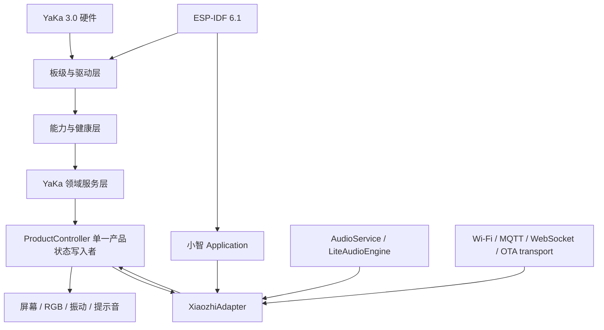

# YaKa 3.0 固件总体架构与开发基线

> 文档状态：`工作基线 v1.0`  
> 最近更新：2026-10-29  
> 适用硬件：YaKa 3.0 / ESP32-C6  
> 适用软件基线：`xiaozhi-esp32 v2.5.2`、ESP-IDF `v6.1`  
> 当前实现阶段：M1 最小板级启动与总线安全态

本文回答后续开发中最容易混淆的五个问题：产品究竟要完成什么、现有硬件实际能做什么、小智上游哪些能力可以直接复用、YaKa 必须自行开发什么，以及代码应按什么边界演进。

本文不是原理图审计报告，也不替代 PRD。实现事实发生冲突时，优先级为：当前活体原理图/PCB与最终复审结论、批准后的 PRD、本文、历史资料。PRD 中仍标记为 `TBD` 的行为，本文不会擅自冻结。

### 0.1 本文依据

| 来源 | 本次采用版本 | 用途与边界 |
|---|---|---|
| YaKa 3.0 产品需求文档 | `v0.3`，2026-10-20，草稿/待产品评审 | 定义产品目标、范围、交互与验收；未批准项继续保留 `候选/TBD` |
| YaKa 3.0 封存前原理图、PCB 与 PRD 全链路复审 | `R1.6`，2026-10-21 | 当前硬件事实、能力边界、引脚/总线/器件和 EVT 风险的主要依据 |
| EasyEDA Pro 活体工程 | YaKa v3.0，复审记录中的工程 UUID | 原理图或 PCB 变更后优先于本文；变更必须重新同步固件硬件契约 |
| xiaozhi-esp32 | tag `v2.5.2`，commit `49b4380` | 当前软件脚手架和可复用能力的精确基线，不代表永久追随上游 `main` |
| ESP-IDF | 官方 `v6.1` 镜像 | 编译器、组件、C6 target 和构建行为基线 |
| 历史 `yaka-firmware` 与旧架构材料 | 只作线索 | 不作为编译环境、驱动接口、引脚或功能状态的权威来源 |

PRD 与硬件审计原文保存在 YaKa 项目资料区，不复制进固件仓库，以免形成两份可独立修改的“真相”。本文件只固化固件开发所需的已确认结论和明确未决项。

## 1. 项目理解

YaKa 3.0 是一款轻薄、便携、Wi-Fi-only、带非触控屏幕和实体导航的 AI 终端。其两个第一层任务是：

1. AI 语音对话：采集、云端处理、播放、打断和失败恢复；
2. 本地录音：快速开始、持续可感知、可靠保存、异常掉电后尽量恢复。

屏幕、四向键、动作键、NFC、IMU、RGB 和振动都服务于上述主线，不应各自膨胀成无关功能集合。3.0 明确不包含 4G/SIM、5 GHz Wi-Fi、主动式蓝牙音频、摄像头、触摸和游戏功能。

MVP 还必须形成配网、离线降级、文件管理、NFC 只读业务、用户确认 OTA、诊断和错误恢复闭环。当前 PRD 仍是待产品评审稿；按键语义、录音格式和时长、NFC 业务、离线范围、量化延迟/续航等参数仍是产品决策，不允许由驱动代码反向决定。

## 2. 已冻结的技术基线

| 对象 | 当前基线 | 对固件的直接约束 |
|---|---|---|
| SoC | ESP32-C6，RISC-V，512 KiB HP SRAM + 16 KiB LP SRAM | 不存在外部 PSRAM；所有并发功能必须在内部 SRAM 预算内成立 |
| 程序存储 | PUYA PY25Q128HA，16 MiB 外置 Flash | 首板 DIO/80 MHz；双 OTA 槽；资源与程序分区 |
| 网络 | 2.4 GHz Wi-Fi | 不实现 4G 或 5 GHz 回退 |
| 显示 | H0160S002 V1 / ST7789，200×320，非触控 | GPIO6 是 MOSI、GPIO7 是 SCLK；网名不能作为真实功能依据 |
| 音频输入 | ES7210 + 两颗模拟麦；CH3 为播放参考 | 双麦和参考通道需按实际 slot 验证；CH3 不是第三颗环境麦 |
| 音频输出 | ES8311 → HT8691R → 8 Ω / 1 W 扬声器 | DAC 稳定后才能开 PA；必须限幅，停止时先关 PA |
| 本地存储 | TF / SDSPI，无 card-detect | GPIO18 MOSI、19 CLK、20 MISO、15 CS；通过挂载结果判断卡状态 |
| 共享 I²C | GPIO10 SDA、GPIO11 SCL，首板 100 kHz | 五个固定地址无冲突；每个设备必须有超时和故障隔离 |
| NFC | PN532，I²C，首发只读，无 IRQ、无可控独立复位 | 采用有超时的轮询；失败不能阻塞首页或录音 |
| IMU | QMI8658A，I²C 0x6A，无 IRQ | 当前只能轮询，不承诺深睡手势唤醒 |
| 输入 | DPAD ADC 梯 + ACT_A/ACT_B + PWR_A/PWR_B | ADC 阈值必须用实板标定；PWR_A/B 不能从 MASTER_SW 硬关断状态唤醒 |
| 反馈 | 单颗 RGB、五灯链、3 V ERM 振动 | 上电默认全灭/马达关闭；限制 RGB 总亮度 |
| 电源 | MASTER_SW 直接硬切整机电源 | 任意时刻掉电是真实场景，录音、FAT、NVS、OTA 都必须可恢复 |
| 电池/充电 | BAT ADC + LGS4056H 自治充电 | MCU 只能估算电压，不能可靠区分完整充电状态，UI 不得虚构“已充满” |

### 2.1 I²C 固定地址

| 器件 | 7-bit 地址 | 角色 |
|---|---:|---|
| ES8311 | `0x18` | 播放 DAC |
| PCA9557 | `0x19` | LCD、马达等控制 |
| PN532 | `0x24` | NFC 只读轮询 |
| ES7210 | `0x41` | 双麦 ADC / 播放参考 |
| QMI8658A | `0x6A` | IMU |

PCA9557 上电必须先写 Output Port=`0x40`，再写 Configuration=`0x38`，最后读回验证。顺序反转可能短暂点亮背光、驱动马达或误选 LCD。M1 将 IO3/IO4/IO5 保持输入，其中 IO4 涉及历史 `PWR_EN` 链路，在重新确认产品语义前不主动驱动。

## 3. C6 无 PSRAM 的架构结论

经典 ESP32-C6 不支持外部 PSRAM，这不是封装差异，也不是少焊一颗存储器。更换 C6 的 QFN32/QFN40 封装不会得到 PSRAM；ESP32-C61 是另一颗 SoC，不是 C6 的封装选项或可直接替换料号。

这不会阻止 YaKa 完成联网对话、局部刷新 UI、流式录音、TF 存储、NFC 和 OTA，但会排除“用大内存掩盖架构问题”的实现方式：

- 200×320 RGB565 单个全屏缓冲为 128,000 字节，约 125 KiB；禁止默认采用全屏双缓冲；
- LCD 使用按实测选择高度的局部行缓冲，DMA 缓冲要有明确所有权；
- 音频、网络和 TF 写入使用固定容量队列、流式处理和背压，不使用无界容器积压；
- 大字体、图片、提示音和模型放在 Flash/资源分区，按需读取，不整体复制到 RAM；
- 长录音写入 TF，不把录音数据长期留在内部 RAM 或程序 Flash；
- 每个里程碑记录空闲内部堆、最大连续块、任务栈高水位、队列峰值和丢帧计数；
- Wi-Fi + UI + 录音/播放 + TF 写入的并发压力测试是发布门禁，不是后期优化项。

小智 v2.5.2 在 C6 上使用 `LiteAudioEngine`：上行是原始单声道 PCM，不提供 S3/P4/S31 的 AFE FD AEC。硬件上的 ES7210 播放参考通道只提供算法输入基础，并不自动产生 C6 端设备 AEC。第一版应采用服务端 AEC 或半双工/明确打断策略；若产品要求 C6 本地全双工 AEC，必须单独做算法、算力、内存和声学验证，不能视为上游已有能力。

## 4. 小智上游的复用边界

原则是“复用稳定基础设施，隔离 YaKa 产品差异”，而不是复制一份上游代码后全面魔改。

| 能力 | 复用策略 | 说明 |
|---|---|---|
| 构建系统、组件管理、C6 target | 直接复用 | YaKa 只增加独立 board 选择链 |
| `Board` / `WifiBoard` 抽象 | 直接复用并派生 | 引脚、外设实例和安全时序只放在 YaKa board 目录 |
| Wi-Fi 配网与连接管理 | 优先复用 | YaKa 增加屏幕状态映射和产品恢复入口 |
| `Application` 主事件循环 | 复用，建立窄适配层 | 不让 YaKa 业务遍布上游核心文件 |
| MQTT/WebSocket 协议与音频上下行 | 直接复用 | 后端协议版本仍需产品绑定 |
| `AudioService`、Opus、固定容量队列 | 直接复用 | C6 使用 `LiteAudioEngine`；禁用设备端 AEC |
| ES8311/ES7210 codec 基础 | 参考并复用公共实现 | YaKa 仍需核对 I²S slot、双麦、参考通道、PA 时序和录音分流 |
| LVGL、字体和资源打包 | 复用基础设施 | YaKa 自行实现 200×320 非触控页面、局部缓冲和实体键焦点模型 |
| 设置/NVS、版本与基础诊断 | 复用并扩展 | 需增加硬件 revision、能力健康和 YaKa 错误码 |
| OTA 下载与双分区基础 | 复用传输，重做产品策略 | 必须加入用户确认、任务互斥、启动自检、确认与回滚门禁 |
| MCP/工具调用能力 | 可选复用 | 不进入 M1，也不能挤占核心录音可靠性预算 |

以下内容不能从上游“自动继承”：YaKa 产品状态机、本地录音和文件恢复、NFC 业务、按键语义、充电状态推断、RGB/振动语义、本地 AEC、整机功耗与声学参数。

## 5. 目标软件架构



### 5.1 板级与驱动层

目录以 `main/boards/chatchat/hi-yaka-v3` 为唯一硬件真值入口，负责：

- pin、总线、地址、外设构造和上电安全态；
- I²C 总线恢复、PCA9557、LCD、按键、TF、音频、NFC、IMU、RGB、振动、电池 ADC；
- 暴露能力接口，不决定“按键 A 开始录音”之类产品语义；
- 单个非关键外设失败时降级并上报健康状态，不无限重启整机。

硬件相关实现优先留在 board 目录。只有确实可被多个上游板型复用、且维护收益大于同步成本时，才向上游公共目录抽取。

### 5.2 能力与健康层

用显式 capability/health 表表示运行时事实，例如：`display_ready`、`storage_mounted`、`audio_capture_ready`、`nfc_ready`、`network_ready`。产品层基于能力决定允许动作，不通过“有没有某个 C++ 对象”猜测功能可用性。

每个能力至少有 `unavailable / initializing / ready / degraded / failed` 状态和稳定错误码。诊断页面、UART 日志和自动测试使用同一来源，避免 UI 与日志互相矛盾。

### 5.3 YaKa 领域服务层

建议在后续里程碑逐步建立 `main/yaka/`，而不是一次性复制旧仓库组件：

| 服务 | 唯一职责 |
|---|---|
| `DialogueService` | 将产品对话动作映射到小智会话，不重新实现网络协议 |
| `RecorderService` | 录音开始/停止、流式写入、checkpoint、文件完成和掉电恢复 |
| `StorageService` | TF 挂载、容量、文件索引、原子操作和错误隔离 |
| `NfcService` | PN532 轮询、超时、解析和业务事件，不直接切换 UI 页面 |
| `InputService` | ADC 梯标定、按键去抖、短按/长按事件；不包含页面语义 |
| `FeedbackService` | 屏幕、RGB、振动、声音的统一语义和优先级 |
| `PowerService` | 电量估算、低电量策略、受控收尾；不虚构不可观测充电状态 |
| `UpdateService` | 在上游 OTA transport 上增加确认、前置条件、自检和回滚策略 |
| `DiagnosticsService` | 版本、复位原因、堆、栈、外设健康和匿名化错误信息 |

### 5.4 产品状态协调

不建立两个相互争抢的全局状态机。建议由 `ProductController` 作为 YaKa 产品状态唯一写入者，维护多个正交维度：

- `PowerPhase`：启动、运行、受控收尾、等待硬关断、恢复；
- `ForegroundMode`：首页、对话、录音、NFC、设置、OTA、错误；
- `Connectivity`：离线、配网、连接中、在线、服务异常；
- `DialoguePhase`：从小智 `DeviceStateMachine` 只读映射聆听/处理/播放等状态；
- `CapabilityHealth`：来自能力层的外设可用性。

所有 ISR、驱动回调和后台任务只投递有界事件，不直接改产品状态或 UI。状态转换在单一上下文串行执行；UI 只渲染状态，不能反向拥有业务真值。

## 6. 音频与录音数据路径

### 6.1 对话路径

```text
ES7210/I²S → AudioCodec → AudioService → LiteAudioEngine
             → 单声道 16 kHz PCM → Opus → MQTT/WebSocket → 云端
云端 → Opus → AudioService → ES8311/I²S → HT8691R → Speaker
```

`LiteAudioEngine` 在多通道输入时只取第一个通道作为语音上行。YaKa 接入真实 codec 前必须冻结 ES7210 的 slot 顺序，并证明第一通道确实是预期麦克风。播放参考不得误排到第一通道。

### 6.2 本地录音路径

I²S RX 只能有一个所有者。不得让“小智对话任务”和“录音任务”同时直接读取 DMA。推荐在 YaKa codec/capture adapter 处做非阻塞分流：

1. AudioService 继续获得上游所需 PCM；
2. 录音启用时，把同一批采集帧引用或复制到固定块池；
3. Recorder task 独立封装并顺序写 TF；
4. 队列满时记录丢帧并进入明确错误策略，不能阻塞 I²S DMA；
5. 停止时完成容器头、`fsync`、关闭并将 `.part` 原子改名为正式文件。

录音采样率、通道数、格式、分段、文件名和最大时长仍由 PRD 决定。实现之前先用原始 PCM 采集验证双麦、参考通道、增益、底噪和串扰，不提前把未验证参数固化为产品格式。

## 7. 启动、运行与故障隔离

初始化顺序固定为安全性优先：

1. 保持 PA、背光、RGB、马达关闭；记录复位原因、Flash ID、内部堆；
2. I²C 100 kHz，PCA9557 先安全锁存值、后方向、再 readback；
3. 探测五个固定地址并建立 capability health；
4. LCD 复位和初始化成功后才开背光；
5. TF 低速挂载、读写和恢复检查；无卡不得阻塞系统启动；
6. 配置 ES7210/ES8311 和 I²S，保持 PA 关闭，音频稳定后才使能；
7. NFC/IMU 采用有超时的低优先级轮询；
8. 标定/读取 ADC，初始化两条 RGB 链为全灭，马达保持关闭；
9. ProductController 根据能力表进入配网、首页、离线或恢复页。

I²C 设备、NFC、IMU、RGB 等非关键能力失败时应降级；Flash、关键配置或产品核心所需存储失败时进入可解释恢复状态。看门狗用于检测死锁，不用于掩盖持续初始化失败。

## 8. 内存、任务与并发规则

| 执行单元 | 责任 | 禁止行为 |
|---|---|---|
| I²S/DMA 回调 | 搬运、时间戳、通知 | 文件写入、网络发送、I²C、长日志、动态大分配 |
| 上游音频任务 | 输入、Lite engine、Opus、播放 | 直接管理 TF 文件或产品页面 |
| Recorder task | 容器化和顺序写 TF | 阻塞采集任务；无界缓存 |
| ProductController | 串行处理产品事件和转换 | 执行耗时 I/O；被驱动回调重入 |
| UI task | 局部刷新和焦点导航 | 修改业务真值；全屏双缓冲默认常驻 |
| Network task | 配网、会话、上传/下载 | 直接持有录音 DMA 缓冲 |
| Housekeeping | 电量、IMU/NFC、指标 | 高频无界轮询；阻塞核心任务 |

所有跨任务队列必须有容量、超时、满载策略和观测指标。禁止以 `std::deque` 或不断扩容的 `vector` 作为长期数据积压方案。是否引入内存池必须由实板堆碎片和延迟数据决定。

## 9. Flash、配置与数据可靠性

M1 的 16 MiB 分区结果为：NVS 16 KiB、OTA data 8 KiB、两个 4032 KiB app slot、4000 KiB assets。首次 IDF 6.1 构建的 `xiaozhi.bin` 为 `0x1d3e30` 字节，最小 app 分区剩余 54%；资源镜像为 1,324,917 字节。这只说明静态容量充足，不代表运行时内部 RAM 充足。

配置和数据规则：

- Wi-Fi、token、设备身份和密钥不得提交到 Git；
- 录音只存 TF；临时文件、checkpoint、原子完成和启动恢复必须成套实现；
- NVS 写入应版本化，迁移失败进入恢复而不是静默清空；
- OTA 与录音/文件提交互斥；硬切电源故障注入必须覆盖两个 OTA 槽和 TF；
- Secure Boot、Flash Encryption、NVS Encryption 只能在密钥托管、工厂烧录和返修流程成立后启用；
- 日志不输出 Wi-Fi 密码、token、完整 NFC payload 或用户录音内容。

## 10. 版本控制与上游同步

- `origin`：`njueeRay/hi-yaka-firmware` 私有产品仓库；
- `upstream`：`78/xiaozhi-esp32`，只拉取、禁止误推；
- `main`：可构建的产品主线；
- `feature/*`：YaKa 功能；
- `sync/xiaozhi-vX.Y.Z`：只做上游版本升级和冲突处理。

产品开发固定在明确的小智 release/tag 上，不追随上游 `main`。上游升级使用独立 PR 和 merge commit；功能 PR 默认 squash。同步 PR 不混入新产品功能，并至少构建 YaKa C6 板型和一个上游 C6 代表板型。详细流程见仓库根目录 `UPSTREAM.md`。

Raynode 正式工作区为 `/srv/projects/hi-yaka-firmware`，使用固定 `espressif/idf:v6.1` 镜像。仓库级 deploy key 允许该服务器直接拉取和推送本仓库，但不授予账户其他仓库权限。

## 11. 分阶段实现建议

这些阶段是工程执行建议，不替代 PRD 版本审批。

| 阶段 | 目标 | 退出证据 |
|---|---|---|
| M1 | 仓库、固定基线、C6 构建、启动诊断、I²C/PCA9557 安全态 | host tests、IDF 6.1 构建、首板 UART/Flash/I²C 日志 |
| M2 | LCD、实体键、RGB、振动、电池 ADC 和最小诊断页 | 局部刷新内存数据、按键实板标定、反馈和电量曲线 |
| M3 | ES7210/ES8311、双麦、播放、PA 时序、声学基线 | 通道映射、底噪/失真/增益、打断和服务端 AEC 验证 |
| M4 | TF 和可靠本地录音 | 长录音、文件互操作、随机硬切恢复、无卡/满卡/坏卡矩阵 |
| M5 | Wi-Fi 配网与 AI 对话产品闭环 | 首次配网、断网恢复、多轮对话、播放打断和堆稳定性 |
| M6 | NFC 只读业务、设置、离线降级和文件管理 | 已批准 NFC 场景、超时取消、离线能力和页面无死路 |
| M7 | 用户确认 OTA、回滚、低电量策略和发布硬化 | 坏包/断网/断电回滚、并发压力、功耗温升、发布证据包 |

## 12. 验证门禁

每个功能 PR 至少回答：关联哪些 `YAKA-*` 需求、修改哪一层、失败如何降级、占用多少 Flash/RAM/栈、如何在实板复现和验收。

发布前必须覆盖：

- 编译：host contract tests、YaKa IDF 6.1 build、上游同步回归；
- 静态：分区、引脚、I²C 地址、PCA9557 写入顺序和敏感配置扫描；
- 实板：Flash ID/容量、五地址扫描、安全默认态、LCD、音频、TF、NFC、按键和反馈；
- 可靠性：长时间录音、弱网、掉电、满卡、拔卡、服务器错误、看门狗和 OTA 故障注入；
- 资源：启动/稳态/峰值内部堆、最大连续块、各任务栈高水位、音频丢帧、UI 帧率和队列峰值；
- 整机：Wi-Fi TX + 背光 + 音频 + TF + RGB 并发下的电源纹波、温升、功耗和用户可理解性。

“编译成功”只证明配置和链接成立；“驱动返回成功”只证明一次调用成立；只有可重复实板证据才能把 capability 从 `unverified` 提升为 `ready`。

## 13. 当前状态

截至 2026-10-29：M1 软件基线已完成 IDF 6.1 编译和链接，真实硬件仍未连接，因此阶段结论是 `软件基线可进入首板 bring-up`，不是“硬件适配完成”。LCD、TF、真实音频、NFC 业务、按键产品语义和 OTA 产品策略仍未进入实板通过状态。
